# Guild entity-relationship diagrams

GitHub renders these Mermaid diagrams directly. They are generated from
the migrated PostgreSQL catalog, not inferred from SQL text or application rows.

This page covers **122 persisted tables and 283 foreign keys**
in the `guild` schema. Every table is owned by one domain below; shared parents
reappear as key-only anchors. Flyway history and views are outside the
physical ER diagrams.

The diagrams describe persistence and constraints, not a running Kafka, CoC,
Discord, or Sheets integration. SQL remains authoritative for all columns,
permissions, checks, and temporal exclusions; the guild service enforces the
business rules.

- [Feature requirements](../feature-specs/README.md)
- [Current star-schema design](guild-star-schema.md)
- [SQL migrations](../../services/guild/schema/src/main/resources/db/migration)
- [Schema setup and behavior](../../services/guild/schema/README.md)
- [Generator](../../tools/postgres/generate-guild-erd.py)

## Reading the diagrams

- PK means primary key; FK means foreign key; UK marks a single-column unconditional unique key.
- Composite unique/index columns are retained without claiming each column is individually unique.
- Each relationship is one declared FK. Its label is the PostgreSQL constraint name.
- Parent optionality follows FK nullability and MATCH semantics; generated non-null literals count as required.
- Child cardinality is zero-or-one when an unconditional unique key proves it, otherwise zero-or-many.
- Solid lines identify FKs contained in the child primary key; other relationships are dashed.
- Partial unique indexes, CHECK constraints, and temporal exclusions impose additional constraints.
- Selected business columns supplement all PK/FK and ordinary unique/index columns.

## Domains

| Diagram | Domain-owned tables |
| --- | ---: |
| [Shared identities](#shared-identities) | 7 |
| [Configuration and audit](#configuration-and-audit) | 8 |
| [Account links and attribution](#account-links-and-attribution) | 5 |
| [Clan membership evidence](#clan-membership-evidence) | 5 |
| [Shared war evidence](#shared-war-evidence) | 7 |
| [Player profiles and raids](#player-profiles-and-raids) | 6 |
| [Clan Games collection](#clan-games-collection) | 5 |
| [Clan Games assessments](#clan-games-assessments) | 3 |
| [Discord presence and roles](#discord-presence-and-roles) | 5 |
| [Chat XP and ranks](#chat-xp-and-ranks) | 7 |
| [Warnings and moderation](#warnings-and-moderation) | 8 |
| [CWL registration and signups](#cwl-registration-and-signups) | 13 |
| [CWL plans benches and exports](#cwl-plans-benches-and-exports) | 13 |
| [Custom events](#custom-events) | 5 |
| [Notification intents and Kafka](#notification-intents-and-kafka) | 16 |
| [Notification dispatch](#notification-dispatch) | 1 |
| [Desired role delivery](#desired-role-delivery) | 5 |
| [Leaderboard calendars](#leaderboard-calendars) | 3 |

## Shared identities

Stable Discord and game identities are shared across activity stars.

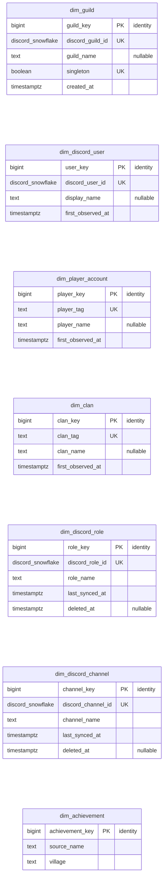

## Configuration and audit

Current configuration and immutable audit evidence have separate authority rules.

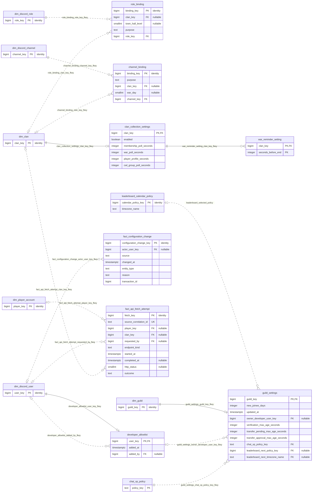

## Account links and attribution

Actual links, verification, approved transfers, and metric continuity are distinct.

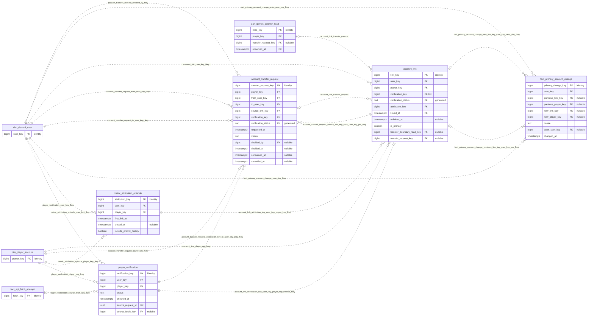

## Clan membership evidence

Observed membership and collection coverage do not imply exact in-game movement times.

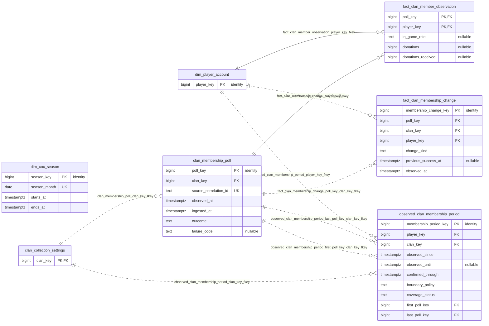

## Shared war evidence

Regular, CWL, and obtainable custom-war evidence share the war and attack grains.

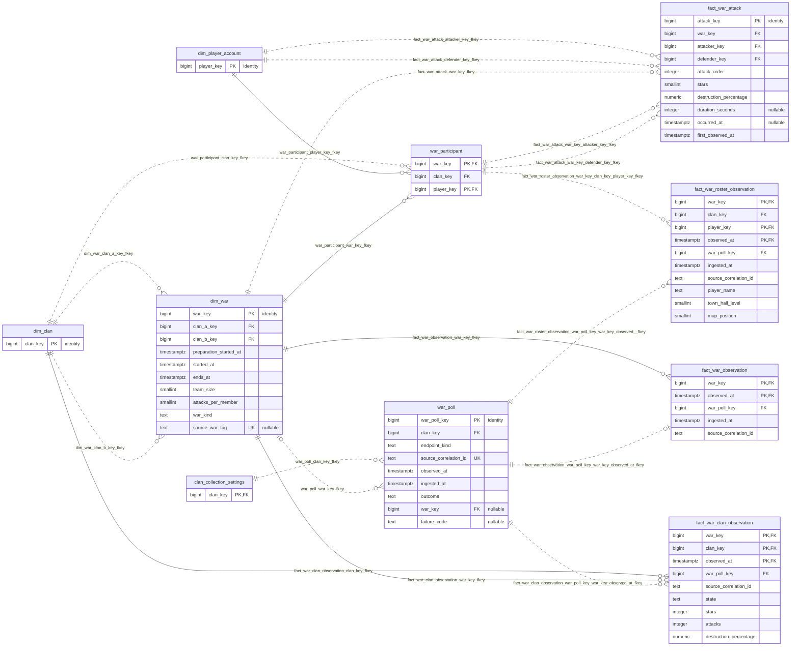

## Player profiles and raids

Counters are nonadditive observations; raid gold remains per account and weekend.

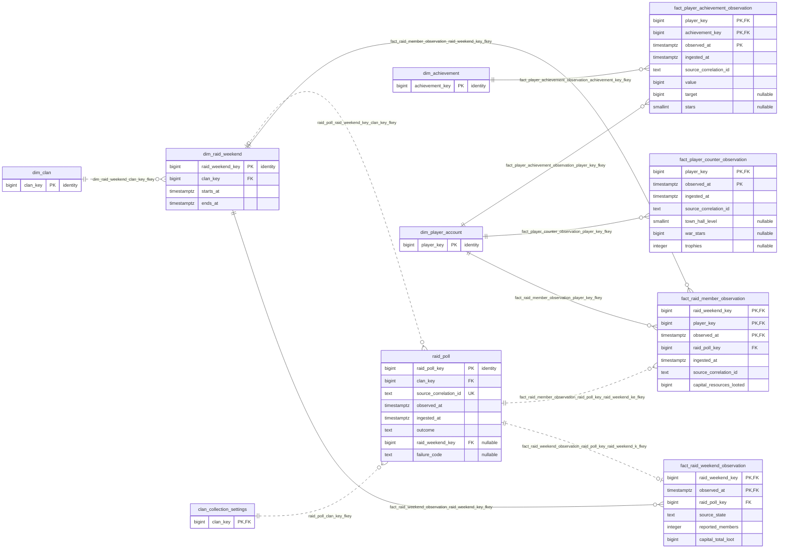

## Clan Games collection

Configured events, boundary reads, affiliation inference, and counter evidence are retained.

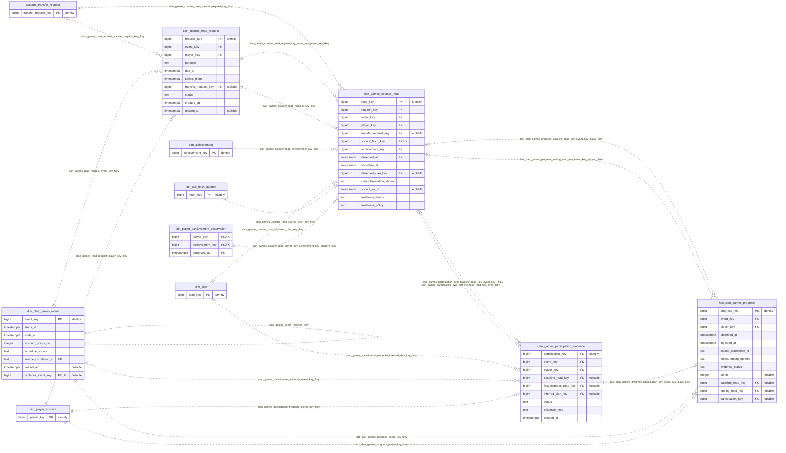

## Clan Games assessments

Versioned account evidence and member-attribution slices support combined rounded targets.

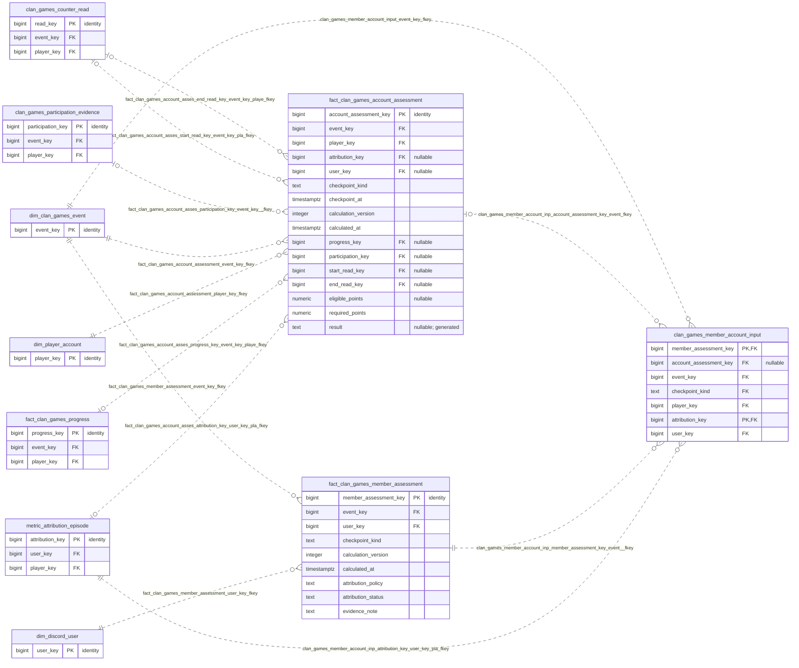

## Discord presence and roles

Confirmed roles and accepted joins are distinct from desired changes or past authority.

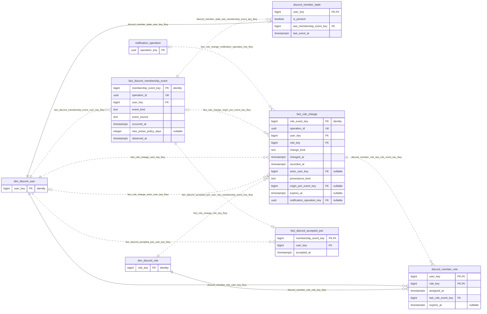

## Chat XP and ranks

One durable message decision includes any XP award; eligibility and rank history retain their own grains.

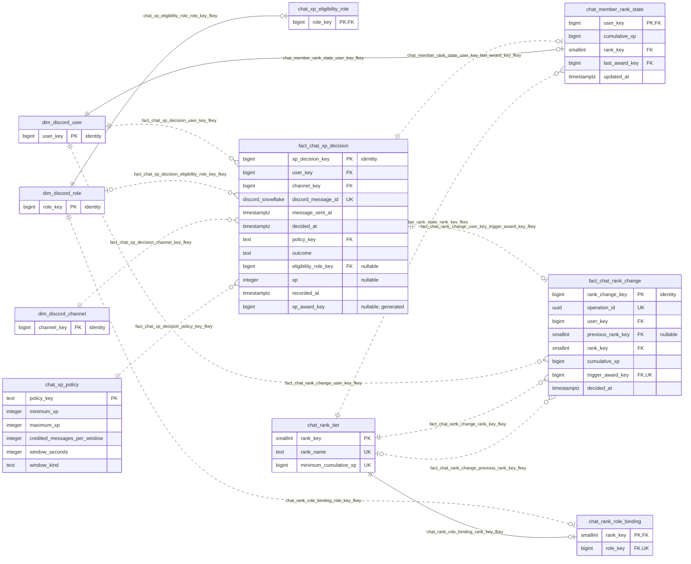

## Warnings and moderation

Warnings, kick decisions, confirmed outcomes, and same-month leadership notices are distinct.

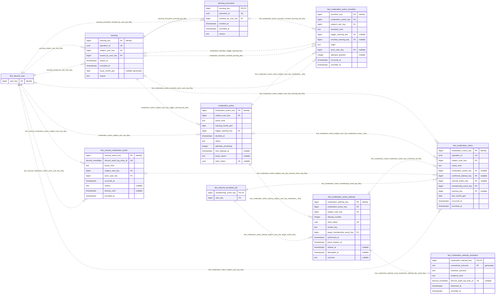

## CWL registration and signups

Signups, strict availability, observed registered pools, and round references are independent.

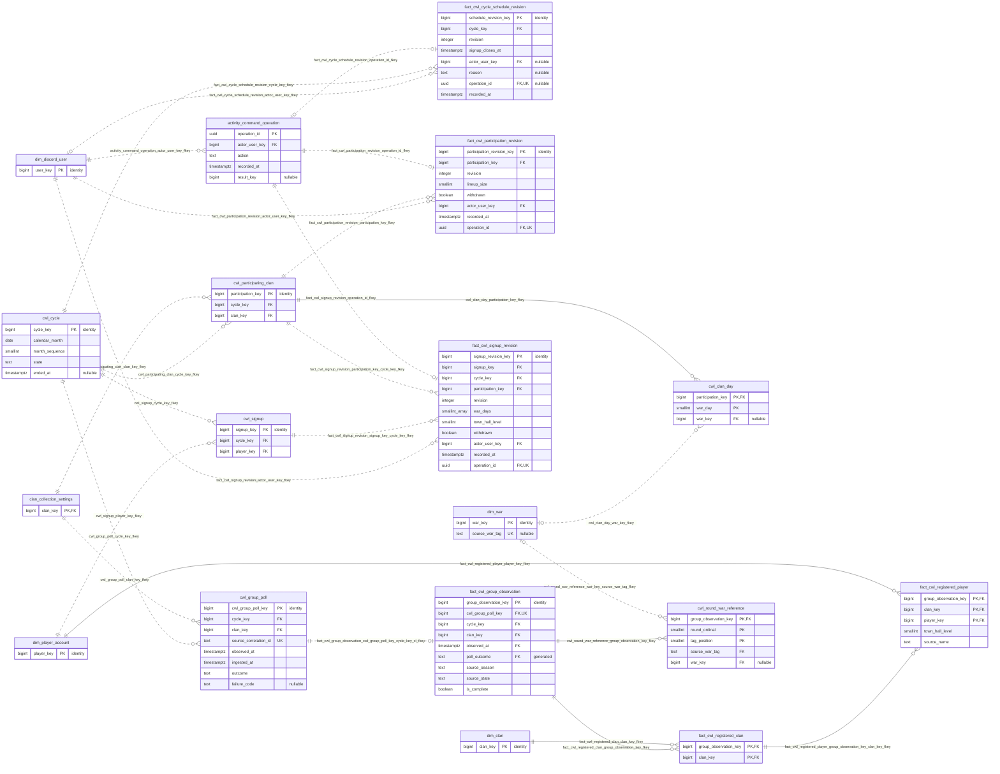

## CWL plans benches and exports

Versioned plans retain inputs, pins, automatic cutoffs, bench service, overrides, and exports.

```mermaid
erDiagram
    direction LR

    cwl_plan_revision {
        bigint plan_key PK "identity"
        bigint participation_key FK
        integer revision
        text source_kind
        bigint actor_user_key FK "nullable"
        text algorithm_version
        text objective
        text phase
        timestamptz created_at
    }

    fact_cwl_plan_input {
        bigint plan_key PK, FK
        bigint participation_key FK
        bigint player_key PK, FK
        bigint signup_revision_key FK
        bigint current_season_stars
        bigint current_season_attacks
        numeric average_destruction "nullable"
        bigint_array source_war_keys
        timestamptz observed_at
    }

    cwl_plan_assignment {
        bigint plan_key PK, FK
        smallint war_day PK
        smallint slot_number PK
        bigint player_key FK
    }

    fact_cwl_manual_pin_revision {
        bigint pin_revision_key PK "identity"
        bigint participation_key FK
        smallint war_day FK
        smallint slot_number
        integer revision
        bigint player_key FK "nullable"
        bigint actor_user_key FK
        text reason
        uuid operation_id FK
        timestamptz recorded_at
    }

    fact_cwl_day_freeze {
        bigint participation_key PK, FK
        smallint war_day PK, FK
        bigint war_key FK
        integer automatic_freeze_minutes
        timestamptz frozen_at
        timestamptz recorded_at
    }

    cwl_replan_request {
        bigint request_key PK "identity"
        bigint participation_key FK
        text reason
        timestamptz requested_at
        bigint completed_plan_key FK "nullable"
    }

    fact_cwl_bench_incident {
        bigint incident_key PK "identity"
        bigint participation_key FK
        bigint player_key FK
        bigint war_key FK
        bigint attack_key FK "nullable"
        text incident_kind
        timestamptz source_observed_at
        timestamptz recorded_at
    }

    fact_cwl_bench_resolution {
        bigint incident_key PK, FK
        text resolution
        smallint war_day "nullable"
        bigint actor_user_key FK "nullable"
        text reason
        timestamptz resolved_at
        uuid operation_id FK, UK "nullable"
    }

    fact_cwl_bench_assignment_revision {
        bigint bench_assignment_revision_key PK "identity"
        bigint incident_key FK
        bigint participation_key FK
        integer revision
        smallint war_day FK "nullable"
        timestamptz recorded_at
    }

    cwl_export_revision {
        bigint export_revision_key PK "identity"
        bigint participation_key FK
        text resource_kind
        bigint signup_revision_key FK "nullable"
        bigint plan_key FK, UK "nullable"
        timestamptz created_at
        text sheets_state
        bigint export_sequence
        text sheet_document_id "nullable"
        text sheet_tab "nullable"
    }

    cwl_export_signup_input {
        bigint export_revision_key PK, FK
        text resource_kind FK
        bigint signup_key PK, FK
        bigint signup_revision_key FK
    }

    cwl_sheet_destination {
        bigint participation_key PK, FK
        text resource_kind PK
        text lease_owner "nullable"
        timestamptz lease_expires_at "nullable"
        uuid fence "nullable"
        bigint confirmed_sequence
    }

    fact_cwl_export_attempt {
        bigint export_attempt_key PK "identity"
        bigint export_revision_key FK
        text export_format
        integer attempt_number
        uuid fence UK "nullable"
        timestamptz lease_expires_at "nullable"
        text outcome "nullable"
        text artifact_reference "nullable"
        text error_code "nullable"
        timestamptz attempted_at
    }

    activity_command_operation {
        uuid operation_id PK
    }

    cwl_clan_day {
        bigint participation_key PK, FK
        smallint war_day PK
        bigint war_key FK "nullable"
    }

    cwl_participating_clan {
        bigint participation_key PK "identity"
    }

    dim_discord_user {
        bigint user_key PK "identity"
    }

    dim_player_account {
        bigint player_key PK "identity"
    }

    dim_war {
        bigint war_key PK "identity"
    }

    fact_cwl_signup_revision {
        bigint signup_revision_key PK "identity"
        bigint signup_key FK
        bigint participation_key FK
    }

    fact_war_attack {
        bigint attack_key PK "identity"
    }

    activity_command_operation |o..o| fact_cwl_bench_resolution : "fact_cwl_bench_resolution_operation_id_fkey"
    activity_command_operation ||..o{ fact_cwl_manual_pin_revision : "fact_cwl_manual_pin_revision_operation_id_fkey"
    cwl_clan_day |o..o{ fact_cwl_bench_assignment_revision : "fact_cwl_bench_assignment_revisi_participation_key_war_day_fkey"
    cwl_clan_day ||..o{ fact_cwl_manual_pin_revision : "fact_cwl_manual_pin_revision_participation_key_war_day_fkey"
    cwl_clan_day ||..o| fact_cwl_day_freeze : "fact_cwl_day_freeze_participation_key_war_day_war_key_fkey"
    cwl_export_revision ||..o{ cwl_export_signup_input : "cwl_export_signup_input_export_revision_key_resource_kind_fkey"
    cwl_export_revision ||..o{ fact_cwl_export_attempt : "fact_cwl_export_attempt_export_revision_key_fkey"
    cwl_participating_clan ||--o{ cwl_sheet_destination : "cwl_sheet_destination_participation_key_fkey"
    cwl_participating_clan ||..o{ cwl_export_revision : "cwl_export_revision_participation_key_fkey"
    cwl_participating_clan ||..o{ cwl_plan_revision : "cwl_plan_revision_participation_key_fkey"
    cwl_participating_clan ||..o{ cwl_replan_request : "cwl_replan_request_participation_key_fkey"
    cwl_participating_clan ||..o{ fact_cwl_bench_incident : "fact_cwl_bench_incident_participation_key_fkey"
    cwl_plan_revision |o..o{ cwl_replan_request : "cwl_replan_request_completed_plan_key_participation_key_fkey"
    cwl_plan_revision |o..o| cwl_export_revision : "cwl_export_revision_plan_key_fkey"
    cwl_plan_revision ||--o{ cwl_plan_assignment : "cwl_plan_assignment_plan_key_fkey"
    cwl_plan_revision ||..o{ fact_cwl_plan_input : "fact_cwl_plan_input_plan_key_participation_key_fkey"
    dim_discord_user |o..o{ cwl_plan_revision : "cwl_plan_revision_actor_user_key_fkey"
    dim_discord_user |o..o{ fact_cwl_bench_resolution : "fact_cwl_bench_resolution_actor_user_key_fkey"
    dim_discord_user ||..o{ fact_cwl_manual_pin_revision : "fact_cwl_manual_pin_revision_actor_user_key_fkey"
    dim_player_account |o..o{ fact_cwl_manual_pin_revision : "fact_cwl_manual_pin_revision_player_key_fkey"
    dim_player_account ||--o{ fact_cwl_plan_input : "fact_cwl_plan_input_player_key_fkey"
    dim_player_account ||..o{ fact_cwl_bench_incident : "fact_cwl_bench_incident_player_key_fkey"
    dim_war ||..o{ fact_cwl_bench_incident : "fact_cwl_bench_incident_war_key_fkey"
    fact_cwl_bench_incident ||--o| fact_cwl_bench_resolution : "fact_cwl_bench_resolution_incident_key_fkey"
    fact_cwl_bench_incident ||..o{ fact_cwl_bench_assignment_revision : "fact_cwl_bench_assignment_rev_incident_key_participation_k_fkey"
    fact_cwl_plan_input ||..o{ cwl_plan_assignment : "cwl_plan_assignment_plan_key_player_key_fkey"
    fact_cwl_signup_revision |o..o{ cwl_export_revision : "cwl_export_revision_signup_revision_key_fkey"
    fact_cwl_signup_revision ||..o{ cwl_export_signup_input : "cwl_export_signup_input_signup_revision_key_signup_key_fkey"
    fact_cwl_signup_revision ||..o{ fact_cwl_plan_input : "fact_cwl_plan_input_signup_revision_key_participation_key_fkey"
    fact_war_attack |o..o{ fact_cwl_bench_incident : "fact_cwl_bench_incident_attack_key_fkey"
```

## Custom events

A custom event has one versioned roster and retains available associated war evidence.

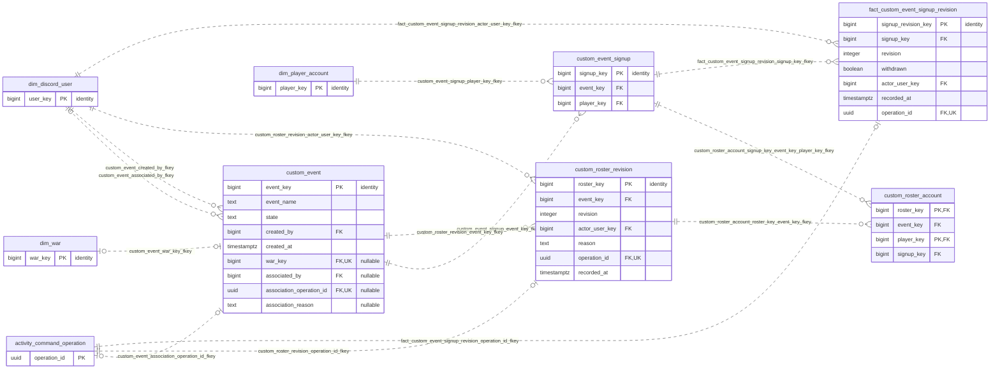

## Notification intents and Kafka

Durable intents, outbox publication, consumer receipts, and catch-up inputs have stable identities.

```mermaid
erDiagram
    direction LR

    notification_report {
        uuid report_key PK
        text logical_report_key UK
        text report_kind
        bigint channel_key FK
        text audience
        discord_snowflake discord_message_id "nullable"
        timestamptz message_confirmed_at "nullable"
        timestamptz created_at
    }

    notification_operation {
        uuid operation_key PK
        text logical_key UK
        text operation_kind
        text notification_kind
        bigint channel_key FK "nullable"
        text audience
        bigint war_key FK "nullable"
        bigint clan_key FK "nullable"
        integer checkpoint_offset_seconds "nullable"
        bigint target_user_key FK "nullable"
        bigint role_generation FK "nullable"
        uuid report_key FK "nullable"
        bigint report_revision "nullable"
        text status
        uuid outbox_key UK
        timestamptz created_at
    }

    notification_mention_role {
        uuid operation_key PK, FK
        bigint role_key PK, FK
    }

    notification_mention_user {
        uuid operation_key PK, FK
        bigint user_key PK, FK
    }

    fact_notification_publication_attempt {
        uuid publication_attempt_key PK
        uuid outbox_key FK
        uuid publication_fence UK
        text outcome
        timestamptz recorded_at
        text kafka_topic "nullable"
        integer kafka_partition "nullable"
        bigint kafka_offset "nullable"
    }

    notification_kafka_receipt {
        uuid receipt_key PK
        uuid operation_key FK
        text consumer_group
        text kafka_topic
        integer kafka_partition
        bigint kafka_offset
        timestamptz received_at
        boolean is_first_for_operation
    }

    notification_catchup_input {
        uuid catchup_operation_key PK, FK
        uuid source_operation_key PK, FK
    }

    fact_notification_disposition {
        uuid operation_key PK, FK
        text disposition
        text cause
        uuid superseded_by_operation_key FK "nullable"
        timestamptz occurred_at
        timestamptz recorded_at
    }

    notification_cwl_context {
        uuid operation_key PK, FK
        bigint cycle_key FK
        bigint schedule_revision_key FK "nullable"
        bigint participation_key FK "nullable"
        bigint plan_key FK "nullable"
        smallint war_day "nullable"
    }

    notification_cwl_signups_context {
        uuid operation_key PK, FK
        bigint export_revision_key FK, UK
        text resource_kind FK
    }

    notification_moderation_context {
        uuid operation_key PK, FK
        text context_kind
        bigint warning_key FK "nullable"
        bigint revoked_warning_key FK "nullable"
        bigint moderation_transition_key FK "nullable"
        bigint moderation_attempt_key FK "nullable"
        bigint moderation_notice_key FK "nullable"
    }

    notification_raid_start_context {
        uuid operation_key PK, FK
        bigint raid_weekend_key FK, UK
    }

    notification_raid_report_context {
        uuid operation_key PK, FK
        bigint raid_weekend_key FK
        timestamptz observed_through FK
        bigint raid_poll_key FK
    }

    notification_clan_games_report_context {
        uuid operation_key PK, FK
        bigint event_key FK
    }

    notification_clan_games_report_assessment {
        uuid operation_key PK, FK
        bigint event_key FK
        bigint member_assessment_key PK, FK
        text checkpoint_kind FK
    }

    notification_clan_games_report_progress {
        uuid operation_key PK, FK
        bigint event_key FK
        bigint player_key PK, FK
        bigint progress_key FK
    }

    cwl_cycle {
        bigint cycle_key PK "identity"
    }

    cwl_export_revision {
        bigint export_revision_key PK "identity"
        text resource_kind
    }

    cwl_participating_clan {
        bigint participation_key PK "identity"
        bigint cycle_key FK
    }

    cwl_plan_revision {
        bigint plan_key PK "identity"
        bigint participation_key FK
    }

    dim_clan {
        bigint clan_key PK "identity"
    }

    dim_clan_games_event {
        bigint event_key PK "identity"
    }

    dim_discord_channel {
        bigint channel_key PK "identity"
    }

    dim_discord_role {
        bigint role_key PK "identity"
    }

    dim_discord_user {
        bigint user_key PK "identity"
    }

    dim_raid_weekend {
        bigint raid_weekend_key PK "identity"
    }

    dim_war {
        bigint war_key PK "identity"
    }

    fact_clan_games_member_assessment {
        bigint member_assessment_key PK "identity"
        bigint event_key FK
        text checkpoint_kind
    }

    fact_clan_games_progress {
        bigint progress_key PK "identity"
        bigint event_key FK
        bigint player_key FK
    }

    fact_cwl_cycle_schedule_revision {
        bigint schedule_revision_key PK "identity"
        bigint cycle_key FK
    }

    fact_moderation_action_attempt {
        bigint moderation_attempt_key PK "identity"
    }

    fact_moderation_action_transition {
        bigint transition_key PK "identity"
    }

    fact_moderation_notice {
        bigint moderation_notice_key PK "identity"
    }

    notification_role_generation {
        bigint user_key PK, FK
        bigint generation PK
    }

    raid_poll {
        bigint raid_poll_key PK "identity"
        timestamptz observed_at
        bigint raid_weekend_key FK "nullable"
    }

    warning {
        bigint warning_key PK "identity"
    }

    warning_revocation {
        bigint warning_key PK, FK
    }

    cwl_cycle ||..o{ notification_cwl_context : "notification_cwl_context_cycle_key_fkey"
    cwl_export_revision ||..o| notification_cwl_signups_context : "notification_cwl_signups_cont_export_revision_key_resource_fkey"
    cwl_participating_clan |o..o{ notification_cwl_context : "notification_cwl_context_participation_key_cycle_key_fkey"
    cwl_plan_revision |o..o{ notification_cwl_context : "notification_cwl_context_plan_key_participation_key_fkey"
    dim_clan |o..o{ notification_operation : "notification_operation_clan_key_fkey"
    dim_clan_games_event ||..o{ notification_clan_games_report_context : "notification_clan_games_report_context_event_key_fkey"
    dim_discord_channel |o..o{ notification_operation : "notification_operation_channel_key_fkey"
    dim_discord_channel ||..o{ notification_report : "notification_report_channel_key_fkey"
    dim_discord_role ||--o{ notification_mention_role : "notification_mention_role_role_key_fkey"
    dim_discord_user |o..o{ notification_operation : "notification_operation_target_user_key_fkey"
    dim_discord_user ||--o{ notification_mention_user : "notification_mention_user_user_key_fkey"
    dim_raid_weekend ||..o{ notification_raid_report_context : "notification_raid_report_context_raid_weekend_key_fkey"
    dim_raid_weekend ||..o| notification_raid_start_context : "notification_raid_start_context_raid_weekend_key_fkey"
    dim_war |o..o{ notification_operation : "notification_operation_war_key_fkey"
    fact_clan_games_member_assessment ||..o{ notification_clan_games_report_assessment : "notification_clan_games_repor_member_assessment_key_event__fkey"
    fact_clan_games_progress ||..o{ notification_clan_games_report_progress : "notification_clan_games_repor_progress_key_event_key_playe_fkey"
    fact_cwl_cycle_schedule_revision |o..o{ notification_cwl_context : "notification_cwl_context_schedule_revision_key_cycle_key_fkey"
    fact_moderation_action_attempt |o..o{ notification_moderation_context : "notification_moderation_context_moderation_attempt_key_fkey"
    fact_moderation_action_transition |o..o{ notification_moderation_context : "notification_moderation_context_moderation_transition_key_fkey"
    fact_moderation_notice |o..o{ notification_moderation_context : "notification_moderation_context_moderation_notice_key_fkey"
    notification_clan_games_report_context ||..o{ notification_clan_games_report_assessment : "notification_clan_games_report_ass_operation_key_event_key_fkey"
    notification_clan_games_report_context ||..o{ notification_clan_games_report_progress : "notification_clan_games_report_pro_operation_key_event_key_fkey"
    notification_operation |o..o{ fact_notification_disposition : "notification_disposition_superseded_by_fkey"
    notification_operation ||--o{ notification_catchup_input : "notification_catchup_input_catchup_operation_key_fkey"
    notification_operation ||--o{ notification_mention_role : "notification_mention_role_operation_key_fkey"
    notification_operation ||--o{ notification_mention_user : "notification_mention_user_operation_key_fkey"
    notification_operation ||--o| fact_notification_disposition : "fact_notification_disposition_operation_key_fkey"
    notification_operation ||--o| notification_catchup_input : "notification_catchup_input_source_operation_key_fkey"
    notification_operation ||--o| notification_clan_games_report_context : "notification_clan_games_report_context_operation_key_fkey"
    notification_operation ||--o| notification_cwl_context : "notification_cwl_context_operation_key_fkey"
    notification_operation ||--o| notification_cwl_signups_context : "notification_cwl_signups_context_operation_key_fkey"
    notification_operation ||--o| notification_moderation_context : "notification_moderation_context_operation_key_fkey"
    notification_operation ||--o| notification_raid_report_context : "notification_raid_report_context_operation_key_fkey"
    notification_operation ||--o| notification_raid_start_context : "notification_raid_start_context_operation_key_fkey"
    notification_operation ||..o{ fact_notification_publication_attempt : "fact_notification_publication_attempt_outbox_key_fkey"
    notification_operation ||..o{ notification_kafka_receipt : "notification_kafka_receipt_operation_key_fkey"
    notification_report |o..o{ notification_operation : "notification_operation_report_key_fkey"
    notification_role_generation |o..o{ notification_operation : "notification_operation_target_user_key_role_generation_fkey"
    raid_poll ||..o{ notification_raid_report_context : "notification_raid_report_cont_raid_poll_key_raid_weekend_k_fkey"
    warning |o..o{ notification_moderation_context : "notification_moderation_context_warning_key_fkey"
    warning_revocation |o..o{ notification_moderation_context : "notification_moderation_context_revoked_warning_key_fkey"
```

## Notification dispatch

One dispatch attempt retains authorization, consumed send permit, and write-once outcome; missing results never permit another ping.

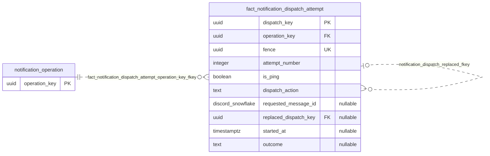

## Desired role delivery

Source requirements produce versioned desired roles; stale queued work must not restore old state.

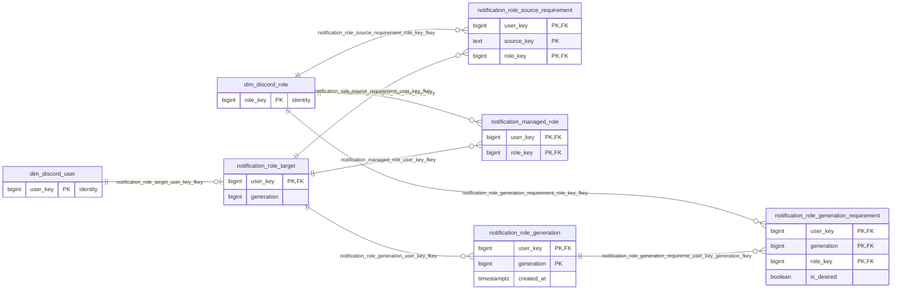

## Leaderboard calendars

Immutable period boundaries retain timezone-policy history and expose transition months.

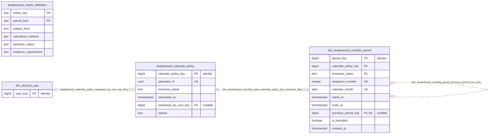

## Full foreign-key reference

<details>
<summary>All 283 declared foreign keys and their column mappings</summary>

| Child table | Constraint | Child columns | Parent table | Referenced columns | Match |
| --- | --- | --- | --- | --- | --- |
| `account_link` | `account_link_attribution_key_user_key_player_key_fkey` | `attribution_key, user_key, player_key` | `metric_attribution_episode` | `attribution_key, user_key, player_key` | SIMPLE |
| `account_link` | `account_link_player_key_fkey` | `player_key` | `dim_player_account` | `player_key` | SIMPLE |
| `account_link` | `account_link_transfer_counter` | `transfer_boundary_read_key, transfer_request_key, player_key, linked_at` | `clan_games_counter_read` | `read_key, transfer_request_key, player_key, observed_at` | SIMPLE |
| `account_link` | `account_link_transfer_request` | `transfer_request_key, user_key, player_key` | `account_transfer_request` | `transfer_request_key, to_user_key, player_key` | SIMPLE |
| `account_link` | `account_link_user_key_fkey` | `user_key` | `dim_discord_user` | `user_key` | SIMPLE |
| `account_link` | `account_link_verification_key_user_key_player_key_verifica_fkey` | `verification_key, user_key, player_key, verification_status` | `player_verification` | `verification_key, user_key, player_key, status` | SIMPLE |
| `account_transfer_request` | `account_transfer_request_decided_by_fkey` | `decided_by` | `dim_discord_user` | `user_key` | SIMPLE |
| `account_transfer_request` | `account_transfer_request_from_user_key_fkey` | `from_user_key` | `dim_discord_user` | `user_key` | SIMPLE |
| `account_transfer_request` | `account_transfer_request_player_key_fkey` | `player_key` | `dim_player_account` | `player_key` | SIMPLE |
| `account_transfer_request` | `account_transfer_request_source_link_key_from_user_key_pla_fkey` | `source_link_key, from_user_key, player_key` | `account_link` | `link_key, user_key, player_key` | SIMPLE |
| `account_transfer_request` | `account_transfer_request_to_user_key_fkey` | `to_user_key` | `dim_discord_user` | `user_key` | SIMPLE |
| `account_transfer_request` | `account_transfer_request_verification_key_to_user_key_play_fkey` | `verification_key, to_user_key, player_key, verification_status` | `player_verification` | `verification_key, user_key, player_key, status` | SIMPLE |
| `activity_command_operation` | `activity_command_operation_actor_user_key_fkey` | `actor_user_key` | `dim_discord_user` | `user_key` | SIMPLE |
| `channel_binding` | `channel_binding_channel_key_fkey` | `channel_key` | `dim_discord_channel` | `channel_key` | SIMPLE |
| `channel_binding` | `channel_binding_clan_key_fkey` | `clan_key` | `dim_clan` | `clan_key` | SIMPLE |
| `chat_member_rank_state` | `chat_member_rank_state_rank_key_fkey` | `rank_key` | `chat_rank_tier` | `rank_key` | SIMPLE |
| `chat_member_rank_state` | `chat_member_rank_state_user_key_fkey` | `user_key` | `dim_discord_user` | `user_key` | SIMPLE |
| `chat_member_rank_state` | `chat_member_rank_state_user_key_last_award_key_fkey` | `user_key, last_award_key` | `fact_chat_xp_decision` | `user_key, xp_award_key` | SIMPLE |
| `chat_rank_role_binding` | `chat_rank_role_binding_rank_key_fkey` | `rank_key` | `chat_rank_tier` | `rank_key` | SIMPLE |
| `chat_rank_role_binding` | `chat_rank_role_binding_role_key_fkey` | `role_key` | `dim_discord_role` | `role_key` | SIMPLE |
| `chat_xp_eligibility_role` | `chat_xp_eligibility_role_role_key_fkey` | `role_key` | `dim_discord_role` | `role_key` | SIMPLE |
| `clan_collection_settings` | `clan_collection_settings_clan_key_fkey` | `clan_key` | `dim_clan` | `clan_key` | SIMPLE |
| `clan_games_counter_read` | `clan_games_counter_read_achievement_key_fkey` | `achievement_key` | `dim_achievement` | `achievement_key` | SIMPLE |
| `clan_games_counter_read` | `clan_games_counter_read_observed_clan_key_fkey` | `observed_clan_key` | `dim_clan` | `clan_key` | SIMPLE |
| `clan_games_counter_read` | `clan_games_counter_read_player_key_achievement_key_observe_fkey` | `player_key, achievement_key, observed_at` | `fact_player_achievement_observation` | `player_key, achievement_key, observed_at` | SIMPLE |
| `clan_games_counter_read` | `clan_games_counter_read_request_key_event_key_player_key_fkey` | `request_key, event_key, player_key` | `clan_games_read_request` | `request_key, event_key, player_key` | SIMPLE |
| `clan_games_counter_read` | `clan_games_counter_read_request_key_fkey` | `request_key` | `clan_games_read_request` | `request_key` | SIMPLE |
| `clan_games_counter_read` | `clan_games_counter_read_source_fetch_key_fkey` | `source_fetch_key` | `fact_api_fetch_attempt` | `fetch_key` | SIMPLE |
| `clan_games_counter_read` | `clan_games_counter_read_transfer_request_key_fkey` | `transfer_request_key` | `account_transfer_request` | `transfer_request_key` | SIMPLE |
| `clan_games_member_account_input` | `clan_games_member_account_inp_account_assessment_key_event_fkey` | `account_assessment_key, event_key, player_key, checkpoint_kind, attribution_key` | `fact_clan_games_account_assessment` | `account_assessment_key, event_key, player_key, checkpoint_kind, attribution_key` | SIMPLE |
| `clan_games_member_account_input` | `clan_games_member_account_inp_attribution_key_user_key_pla_fkey` | `attribution_key, user_key, player_key` | `metric_attribution_episode` | `attribution_key, user_key, player_key` | SIMPLE |
| `clan_games_member_account_input` | `clan_games_member_account_inp_member_assessment_key_event__fkey` | `member_assessment_key, event_key, checkpoint_kind, user_key` | `fact_clan_games_member_assessment` | `member_assessment_key, event_key, checkpoint_kind, user_key` | SIMPLE |
| `clan_games_member_account_input` | `clan_games_member_account_input_event_key_fkey` | `event_key` | `dim_clan_games_event` | `event_key` | SIMPLE |
| `clan_games_participation_evidence` | `clan_games_participation_evid_baseline_read_key_event_key__fkey` | `baseline_read_key, event_key, player_key` | `clan_games_counter_read` | `read_key, event_key, player_key` | SIMPLE |
| `clan_games_participation_evidence` | `clan_games_participation_evid_first_increase_read_key_even_fkey` | `first_increase_read_key, event_key, player_key` | `clan_games_counter_read` | `read_key, event_key, player_key` | SIMPLE |
| `clan_games_participation_evidence` | `clan_games_participation_evidence_event_key_fkey` | `event_key` | `dim_clan_games_event` | `event_key` | SIMPLE |
| `clan_games_participation_evidence` | `clan_games_participation_evidence_inferred_clan_key_fkey` | `inferred_clan_key` | `dim_clan` | `clan_key` | SIMPLE |
| `clan_games_participation_evidence` | `clan_games_participation_evidence_player_key_fkey` | `player_key` | `dim_player_account` | `player_key` | SIMPLE |
| `clan_games_read_request` | `clan_games_read_request_event_key_fkey` | `event_key` | `dim_clan_games_event` | `event_key` | SIMPLE |
| `clan_games_read_request` | `clan_games_read_request_player_key_fkey` | `player_key` | `dim_player_account` | `player_key` | SIMPLE |
| `clan_games_read_request` | `clan_games_read_request_transfer_request_key_fkey` | `transfer_request_key` | `account_transfer_request` | `transfer_request_key` | SIMPLE |
| `clan_membership_poll` | `clan_membership_poll_clan_key_fkey` | `clan_key` | `clan_collection_settings` | `clan_key` | SIMPLE |
| `custom_event` | `custom_event_associated_by_fkey` | `associated_by` | `dim_discord_user` | `user_key` | SIMPLE |
| `custom_event` | `custom_event_association_operation_id_fkey` | `association_operation_id` | `activity_command_operation` | `operation_id` | SIMPLE |
| `custom_event` | `custom_event_created_by_fkey` | `created_by` | `dim_discord_user` | `user_key` | SIMPLE |
| `custom_event` | `custom_event_war_key_fkey` | `war_key` | `dim_war` | `war_key` | SIMPLE |
| `custom_event_signup` | `custom_event_signup_event_key_fkey` | `event_key` | `custom_event` | `event_key` | SIMPLE |
| `custom_event_signup` | `custom_event_signup_player_key_fkey` | `player_key` | `dim_player_account` | `player_key` | SIMPLE |
| `custom_roster_account` | `custom_roster_account_roster_key_event_key_fkey` | `roster_key, event_key` | `custom_roster_revision` | `roster_key, event_key` | SIMPLE |
| `custom_roster_account` | `custom_roster_account_signup_key_event_key_player_key_fkey` | `signup_key, event_key, player_key` | `custom_event_signup` | `signup_key, event_key, player_key` | SIMPLE |
| `custom_roster_revision` | `custom_roster_revision_actor_user_key_fkey` | `actor_user_key` | `dim_discord_user` | `user_key` | SIMPLE |
| `custom_roster_revision` | `custom_roster_revision_event_key_fkey` | `event_key` | `custom_event` | `event_key` | SIMPLE |
| `custom_roster_revision` | `custom_roster_revision_operation_id_fkey` | `operation_id` | `activity_command_operation` | `operation_id` | SIMPLE |
| `cwl_clan_day` | `cwl_clan_day_participation_key_fkey` | `participation_key` | `cwl_participating_clan` | `participation_key` | SIMPLE |
| `cwl_clan_day` | `cwl_clan_day_war_key_fkey` | `war_key` | `dim_war` | `war_key` | SIMPLE |
| `cwl_export_revision` | `cwl_export_revision_participation_key_fkey` | `participation_key` | `cwl_participating_clan` | `participation_key` | SIMPLE |
| `cwl_export_revision` | `cwl_export_revision_plan_key_fkey` | `plan_key` | `cwl_plan_revision` | `plan_key` | SIMPLE |
| `cwl_export_revision` | `cwl_export_revision_signup_revision_key_fkey` | `signup_revision_key` | `fact_cwl_signup_revision` | `signup_revision_key` | SIMPLE |
| `cwl_export_signup_input` | `cwl_export_signup_input_export_revision_key_resource_kind_fkey` | `export_revision_key, resource_kind` | `cwl_export_revision` | `export_revision_key, resource_kind` | SIMPLE |
| `cwl_export_signup_input` | `cwl_export_signup_input_signup_revision_key_signup_key_fkey` | `signup_revision_key, signup_key` | `fact_cwl_signup_revision` | `signup_revision_key, signup_key` | SIMPLE |
| `cwl_group_poll` | `cwl_group_poll_clan_key_fkey` | `clan_key` | `clan_collection_settings` | `clan_key` | SIMPLE |
| `cwl_group_poll` | `cwl_group_poll_cycle_key_fkey` | `cycle_key` | `cwl_cycle` | `cycle_key` | SIMPLE |
| `cwl_participating_clan` | `cwl_participating_clan_clan_key_fkey` | `clan_key` | `clan_collection_settings` | `clan_key` | SIMPLE |
| `cwl_participating_clan` | `cwl_participating_clan_cycle_key_fkey` | `cycle_key` | `cwl_cycle` | `cycle_key` | SIMPLE |
| `cwl_plan_assignment` | `cwl_plan_assignment_plan_key_fkey` | `plan_key` | `cwl_plan_revision` | `plan_key` | SIMPLE |
| `cwl_plan_assignment` | `cwl_plan_assignment_plan_key_player_key_fkey` | `plan_key, player_key` | `fact_cwl_plan_input` | `plan_key, player_key` | SIMPLE |
| `cwl_plan_revision` | `cwl_plan_revision_actor_user_key_fkey` | `actor_user_key` | `dim_discord_user` | `user_key` | SIMPLE |
| `cwl_plan_revision` | `cwl_plan_revision_participation_key_fkey` | `participation_key` | `cwl_participating_clan` | `participation_key` | SIMPLE |
| `cwl_replan_request` | `cwl_replan_request_completed_plan_key_participation_key_fkey` | `completed_plan_key, participation_key` | `cwl_plan_revision` | `plan_key, participation_key` | SIMPLE |
| `cwl_replan_request` | `cwl_replan_request_participation_key_fkey` | `participation_key` | `cwl_participating_clan` | `participation_key` | SIMPLE |
| `cwl_round_war_reference` | `cwl_round_war_reference_group_observation_key_fkey` | `group_observation_key` | `fact_cwl_group_observation` | `group_observation_key` | SIMPLE |
| `cwl_round_war_reference` | `cwl_round_war_reference_war_key_source_war_tag_fkey` | `war_key, source_war_tag` | `dim_war` | `war_key, source_war_tag` | SIMPLE |
| `cwl_sheet_destination` | `cwl_sheet_destination_participation_key_fkey` | `participation_key` | `cwl_participating_clan` | `participation_key` | SIMPLE |
| `cwl_signup` | `cwl_signup_cycle_key_fkey` | `cycle_key` | `cwl_cycle` | `cycle_key` | SIMPLE |
| `cwl_signup` | `cwl_signup_player_key_fkey` | `player_key` | `dim_player_account` | `player_key` | SIMPLE |
| `developer_allowlist` | `developer_allowlist_added_by_fkey` | `added_by` | `dim_discord_user` | `user_key` | SIMPLE |
| `developer_allowlist` | `developer_allowlist_user_key_fkey` | `user_key` | `dim_discord_user` | `user_key` | SIMPLE |
| `dim_clan_games_event` | `clan_games_event_replaces_fkey` | `replaces_event_key` | `dim_clan_games_event` | `event_key` | SIMPLE |
| `dim_leaderboard_monthly_period` | `dim_leaderboard_monthly_perio_calendar_policy_key_timezone_fkey` | `calendar_policy_key, timezone_name` | `leaderboard_calendar_policy` | `calendar_policy_key, timezone_name` | SIMPLE |
| `dim_leaderboard_monthly_period` | `dim_leaderboard_monthly_period_previous_period_key_fkey` | `previous_period_key` | `dim_leaderboard_monthly_period` | `period_key` | SIMPLE |
| `dim_raid_weekend` | `dim_raid_weekend_clan_key_fkey` | `clan_key` | `dim_clan` | `clan_key` | SIMPLE |
| `dim_war` | `dim_war_clan_a_key_fkey` | `clan_a_key` | `dim_clan` | `clan_key` | SIMPLE |
| `dim_war` | `dim_war_clan_b_key_fkey` | `clan_b_key` | `dim_clan` | `clan_key` | SIMPLE |
| `discord_member_role` | `discord_member_role_last_role_event_key_fkey` | `last_role_event_key` | `fact_role_change` | `role_event_key` | SIMPLE |
| `discord_member_role` | `discord_member_role_role_key_fkey` | `role_key` | `dim_discord_role` | `role_key` | SIMPLE |
| `discord_member_role` | `discord_member_role_user_key_fkey` | `user_key` | `dim_discord_user` | `user_key` | SIMPLE |
| `discord_member_state` | `discord_member_state_last_membership_event_key_fkey` | `last_membership_event_key` | `fact_discord_membership_event` | `membership_event_key` | SIMPLE |
| `discord_member_state` | `discord_member_state_user_key_fkey` | `user_key` | `dim_discord_user` | `user_key` | SIMPLE |
| `fact_api_fetch_attempt` | `fact_api_fetch_attempt_clan_key_fkey` | `clan_key` | `dim_clan` | `clan_key` | SIMPLE |
| `fact_api_fetch_attempt` | `fact_api_fetch_attempt_player_key_fkey` | `player_key` | `dim_player_account` | `player_key` | SIMPLE |
| `fact_api_fetch_attempt` | `fact_api_fetch_attempt_requested_by_fkey` | `requested_by` | `dim_discord_user` | `user_key` | SIMPLE |
| `fact_chat_rank_change` | `fact_chat_rank_change_previous_rank_key_fkey` | `previous_rank_key` | `chat_rank_tier` | `rank_key` | SIMPLE |
| `fact_chat_rank_change` | `fact_chat_rank_change_rank_key_fkey` | `rank_key` | `chat_rank_tier` | `rank_key` | SIMPLE |
| `fact_chat_rank_change` | `fact_chat_rank_change_user_key_fkey` | `user_key` | `dim_discord_user` | `user_key` | SIMPLE |
| `fact_chat_rank_change` | `fact_chat_rank_change_user_key_trigger_award_key_fkey` | `user_key, trigger_award_key` | `fact_chat_xp_decision` | `user_key, xp_award_key` | SIMPLE |
| `fact_chat_xp_decision` | `fact_chat_xp_decision_channel_key_fkey` | `channel_key` | `dim_discord_channel` | `channel_key` | SIMPLE |
| `fact_chat_xp_decision` | `fact_chat_xp_decision_eligibility_role_key_fkey` | `eligibility_role_key` | `dim_discord_role` | `role_key` | SIMPLE |
| `fact_chat_xp_decision` | `fact_chat_xp_decision_policy_key_fkey` | `policy_key` | `chat_xp_policy` | `policy_key` | SIMPLE |
| `fact_chat_xp_decision` | `fact_chat_xp_decision_user_key_fkey` | `user_key` | `dim_discord_user` | `user_key` | SIMPLE |
| `fact_clan_games_account_assessment` | `fact_clan_games_account_asses_attribution_key_user_key_pla_fkey` | `attribution_key, user_key, player_key` | `metric_attribution_episode` | `attribution_key, user_key, player_key` | SIMPLE |
| `fact_clan_games_account_assessment` | `fact_clan_games_account_asses_end_read_key_event_key_playe_fkey` | `end_read_key, event_key, player_key` | `clan_games_counter_read` | `read_key, event_key, player_key` | SIMPLE |
| `fact_clan_games_account_assessment` | `fact_clan_games_account_asses_participation_key_event_key__fkey` | `participation_key, event_key, player_key` | `clan_games_participation_evidence` | `participation_key, event_key, player_key` | SIMPLE |
| `fact_clan_games_account_assessment` | `fact_clan_games_account_asses_progress_key_event_key_playe_fkey` | `progress_key, event_key, player_key` | `fact_clan_games_progress` | `progress_key, event_key, player_key` | SIMPLE |
| `fact_clan_games_account_assessment` | `fact_clan_games_account_asses_start_read_key_event_key_pla_fkey` | `start_read_key, event_key, player_key` | `clan_games_counter_read` | `read_key, event_key, player_key` | SIMPLE |
| `fact_clan_games_account_assessment` | `fact_clan_games_account_assessment_event_key_fkey` | `event_key` | `dim_clan_games_event` | `event_key` | SIMPLE |
| `fact_clan_games_account_assessment` | `fact_clan_games_account_assessment_player_key_fkey` | `player_key` | `dim_player_account` | `player_key` | SIMPLE |
| `fact_clan_games_member_assessment` | `fact_clan_games_member_assessment_event_key_fkey` | `event_key` | `dim_clan_games_event` | `event_key` | SIMPLE |
| `fact_clan_games_member_assessment` | `fact_clan_games_member_assessment_user_key_fkey` | `user_key` | `dim_discord_user` | `user_key` | SIMPLE |
| `fact_clan_games_progress` | `fact_clan_games_progress_baseline_read_key_event_key_playe_fkey` | `baseline_read_key, event_key, player_key` | `clan_games_counter_read` | `read_key, event_key, player_key` | SIMPLE |
| `fact_clan_games_progress` | `fact_clan_games_progress_ending_read_key_event_key_player__fkey` | `ending_read_key, event_key, player_key` | `clan_games_counter_read` | `read_key, event_key, player_key` | SIMPLE |
| `fact_clan_games_progress` | `fact_clan_games_progress_event_key_fkey` | `event_key` | `dim_clan_games_event` | `event_key` | SIMPLE |
| `fact_clan_games_progress` | `fact_clan_games_progress_participation_key_event_key_playe_fkey` | `participation_key, event_key, player_key` | `clan_games_participation_evidence` | `participation_key, event_key, player_key` | SIMPLE |
| `fact_clan_games_progress` | `fact_clan_games_progress_player_key_fkey` | `player_key` | `dim_player_account` | `player_key` | SIMPLE |
| `fact_clan_member_observation` | `fact_clan_member_observation_player_key_fkey` | `player_key` | `dim_player_account` | `player_key` | SIMPLE |
| `fact_clan_member_observation` | `fact_clan_member_observation_poll_key_fkey` | `poll_key` | `clan_membership_poll` | `poll_key` | SIMPLE |
| `fact_clan_membership_change` | `fact_clan_membership_change_player_key_fkey` | `player_key` | `dim_player_account` | `player_key` | SIMPLE |
| `fact_clan_membership_change` | `fact_clan_membership_change_poll_key_clan_key_fkey` | `poll_key, clan_key` | `clan_membership_poll` | `poll_key, clan_key` | SIMPLE |
| `fact_configuration_change` | `fact_configuration_change_actor_user_key_fkey` | `actor_user_key` | `dim_discord_user` | `user_key` | SIMPLE |
| `fact_custom_event_signup_revision` | `fact_custom_event_signup_revision_actor_user_key_fkey` | `actor_user_key` | `dim_discord_user` | `user_key` | SIMPLE |
| `fact_custom_event_signup_revision` | `fact_custom_event_signup_revision_operation_id_fkey` | `operation_id` | `activity_command_operation` | `operation_id` | SIMPLE |
| `fact_custom_event_signup_revision` | `fact_custom_event_signup_revision_signup_key_fkey` | `signup_key` | `custom_event_signup` | `signup_key` | SIMPLE |
| `fact_cwl_bench_assignment_revision` | `fact_cwl_bench_assignment_rev_incident_key_participation_k_fkey` | `incident_key, participation_key` | `fact_cwl_bench_incident` | `incident_key, participation_key` | SIMPLE |
| `fact_cwl_bench_assignment_revision` | `fact_cwl_bench_assignment_revisi_participation_key_war_day_fkey` | `participation_key, war_day` | `cwl_clan_day` | `participation_key, war_day` | SIMPLE |
| `fact_cwl_bench_incident` | `fact_cwl_bench_incident_attack_key_fkey` | `attack_key` | `fact_war_attack` | `attack_key` | SIMPLE |
| `fact_cwl_bench_incident` | `fact_cwl_bench_incident_participation_key_fkey` | `participation_key` | `cwl_participating_clan` | `participation_key` | SIMPLE |
| `fact_cwl_bench_incident` | `fact_cwl_bench_incident_player_key_fkey` | `player_key` | `dim_player_account` | `player_key` | SIMPLE |
| `fact_cwl_bench_incident` | `fact_cwl_bench_incident_war_key_fkey` | `war_key` | `dim_war` | `war_key` | SIMPLE |
| `fact_cwl_bench_resolution` | `fact_cwl_bench_resolution_actor_user_key_fkey` | `actor_user_key` | `dim_discord_user` | `user_key` | SIMPLE |
| `fact_cwl_bench_resolution` | `fact_cwl_bench_resolution_incident_key_fkey` | `incident_key` | `fact_cwl_bench_incident` | `incident_key` | SIMPLE |
| `fact_cwl_bench_resolution` | `fact_cwl_bench_resolution_operation_id_fkey` | `operation_id` | `activity_command_operation` | `operation_id` | SIMPLE |
| `fact_cwl_cycle_schedule_revision` | `fact_cwl_cycle_schedule_revision_actor_user_key_fkey` | `actor_user_key` | `dim_discord_user` | `user_key` | SIMPLE |
| `fact_cwl_cycle_schedule_revision` | `fact_cwl_cycle_schedule_revision_cycle_key_fkey` | `cycle_key` | `cwl_cycle` | `cycle_key` | SIMPLE |
| `fact_cwl_cycle_schedule_revision` | `fact_cwl_cycle_schedule_revision_operation_id_fkey` | `operation_id` | `activity_command_operation` | `operation_id` | SIMPLE |
| `fact_cwl_day_freeze` | `fact_cwl_day_freeze_participation_key_war_day_war_key_fkey` | `participation_key, war_day, war_key` | `cwl_clan_day` | `participation_key, war_day, war_key` | SIMPLE |
| `fact_cwl_export_attempt` | `fact_cwl_export_attempt_export_revision_key_fkey` | `export_revision_key` | `cwl_export_revision` | `export_revision_key` | SIMPLE |
| `fact_cwl_group_observation` | `fact_cwl_group_observation_cwl_group_poll_key_cycle_key_cl_fkey` | `cwl_group_poll_key, cycle_key, clan_key, observed_at, poll_outcome` | `cwl_group_poll` | `cwl_group_poll_key, cycle_key, clan_key, observed_at, outcome` | SIMPLE |
| `fact_cwl_manual_pin_revision` | `fact_cwl_manual_pin_revision_actor_user_key_fkey` | `actor_user_key` | `dim_discord_user` | `user_key` | SIMPLE |
| `fact_cwl_manual_pin_revision` | `fact_cwl_manual_pin_revision_operation_id_fkey` | `operation_id` | `activity_command_operation` | `operation_id` | SIMPLE |
| `fact_cwl_manual_pin_revision` | `fact_cwl_manual_pin_revision_participation_key_war_day_fkey` | `participation_key, war_day` | `cwl_clan_day` | `participation_key, war_day` | SIMPLE |
| `fact_cwl_manual_pin_revision` | `fact_cwl_manual_pin_revision_player_key_fkey` | `player_key` | `dim_player_account` | `player_key` | SIMPLE |
| `fact_cwl_participation_revision` | `fact_cwl_participation_revision_actor_user_key_fkey` | `actor_user_key` | `dim_discord_user` | `user_key` | SIMPLE |
| `fact_cwl_participation_revision` | `fact_cwl_participation_revision_operation_id_fkey` | `operation_id` | `activity_command_operation` | `operation_id` | SIMPLE |
| `fact_cwl_participation_revision` | `fact_cwl_participation_revision_participation_key_fkey` | `participation_key` | `cwl_participating_clan` | `participation_key` | SIMPLE |
| `fact_cwl_plan_input` | `fact_cwl_plan_input_plan_key_participation_key_fkey` | `plan_key, participation_key` | `cwl_plan_revision` | `plan_key, participation_key` | SIMPLE |
| `fact_cwl_plan_input` | `fact_cwl_plan_input_player_key_fkey` | `player_key` | `dim_player_account` | `player_key` | SIMPLE |
| `fact_cwl_plan_input` | `fact_cwl_plan_input_signup_revision_key_participation_key_fkey` | `signup_revision_key, participation_key` | `fact_cwl_signup_revision` | `signup_revision_key, participation_key` | SIMPLE |
| `fact_cwl_registered_clan` | `fact_cwl_registered_clan_clan_key_fkey` | `clan_key` | `dim_clan` | `clan_key` | SIMPLE |
| `fact_cwl_registered_clan` | `fact_cwl_registered_clan_group_observation_key_fkey` | `group_observation_key` | `fact_cwl_group_observation` | `group_observation_key` | SIMPLE |
| `fact_cwl_registered_player` | `fact_cwl_registered_player_group_observation_key_clan_key_fkey` | `group_observation_key, clan_key` | `fact_cwl_registered_clan` | `group_observation_key, clan_key` | SIMPLE |
| `fact_cwl_registered_player` | `fact_cwl_registered_player_player_key_fkey` | `player_key` | `dim_player_account` | `player_key` | SIMPLE |
| `fact_cwl_signup_revision` | `fact_cwl_signup_revision_actor_user_key_fkey` | `actor_user_key` | `dim_discord_user` | `user_key` | SIMPLE |
| `fact_cwl_signup_revision` | `fact_cwl_signup_revision_operation_id_fkey` | `operation_id` | `activity_command_operation` | `operation_id` | SIMPLE |
| `fact_cwl_signup_revision` | `fact_cwl_signup_revision_participation_key_cycle_key_fkey` | `participation_key, cycle_key` | `cwl_participating_clan` | `participation_key, cycle_key` | SIMPLE |
| `fact_cwl_signup_revision` | `fact_cwl_signup_revision_signup_key_cycle_key_fkey` | `signup_key, cycle_key` | `cwl_signup` | `signup_key, cycle_key` | SIMPLE |
| `fact_discord_accepted_join` | `fact_discord_accepted_join_user_key_fkey` | `user_key` | `dim_discord_user` | `user_key` | SIMPLE |
| `fact_discord_accepted_join` | `fact_discord_accepted_join_user_key_membership_event_key_fkey` | `user_key, membership_event_key` | `fact_discord_membership_event` | `user_key, membership_event_key` | SIMPLE |
| `fact_discord_membership_event` | `fact_discord_membership_event_user_key_fkey` | `user_key` | `dim_discord_user` | `user_key` | SIMPLE |
| `fact_manual_moderation_action` | `fact_manual_moderation_action_actor_user_key_fkey` | `actor_user_key` | `dim_discord_user` | `user_key` | SIMPLE |
| `fact_manual_moderation_action` | `fact_manual_moderation_action_subject_user_key_fkey` | `subject_user_key` | `dim_discord_user` | `user_key` | SIMPLE |
| `fact_moderation_action_attempt` | `fact_moderation_action_attemp_subject_user_key_moderation__fkey` | `subject_user_key, moderation_action_key` | `moderation_action` | `subject_user_key, moderation_action_key` | SIMPLE |
| `fact_moderation_action_attempt` | `fact_moderation_action_attemp_subject_user_key_target_memb_fkey` | `subject_user_key, target_membership_event_key` | `fact_discord_accepted_join` | `user_key, membership_event_key` | SIMPLE |
| `fact_moderation_action_transition` | `fact_moderation_action_transi_subject_user_key_moderation__fkey` | `subject_user_key, moderation_action_key` | `moderation_action` | `subject_user_key, moderation_action_key` | SIMPLE |
| `fact_moderation_action_transition` | `fact_moderation_action_transition_actor_user_key_fkey` | `actor_user_key` | `dim_discord_user` | `user_key` | SIMPLE |
| `fact_moderation_action_transition` | `fact_moderation_action_transition_revoked_warning_key_fkey` | `revoked_warning_key` | `warning_revocation` | `warning_key` | SIMPLE |
| `fact_moderation_action_transition` | `moderation_transition_revoked_warning_fkey` | `subject_user_key, revoked_warning_key` | `warning` | `subject_user_key, warning_key` | SIMPLE |
| `fact_moderation_action_transition` | `moderation_transition_trigger_warning_fkey` | `subject_user_key, trigger_warning_key` | `warning` | `subject_user_key, warning_key` | SIMPLE |
| `fact_moderation_attempt_resolution` | `fact_moderation_attempt_resol_moderation_attempt_key_unres_fkey` | `moderation_attempt_key, unresolved_outcome` | `fact_moderation_action_attempt` | `moderation_attempt_key, outcome` | SIMPLE |
| `fact_moderation_notice` | `fact_moderation_notice_membership_event_key_fkey` | `membership_event_key` | `fact_discord_accepted_join` | `membership_event_key` | SIMPLE |
| `fact_moderation_notice` | `fact_moderation_notice_moderation_action_key_confirmed_att_fkey` | `moderation_action_key, confirmed_attempt_key` | `fact_moderation_action_attempt` | `moderation_action_key, moderation_attempt_key` | SIMPLE |
| `fact_moderation_notice` | `fact_moderation_notice_subject_user_key_fkey` | `subject_user_key` | `dim_discord_user` | `user_key` | SIMPLE |
| `fact_moderation_notice` | `fact_moderation_notice_subject_user_key_manual_action_key_fkey` | `subject_user_key, manual_action_key` | `fact_manual_moderation_action` | `subject_user_key, manual_action_key` | SIMPLE |
| `fact_moderation_notice` | `fact_moderation_notice_subject_user_key_moderation_action__fkey` | `subject_user_key, moderation_action_key` | `moderation_action` | `subject_user_key, moderation_action_key` | SIMPLE |
| `fact_moderation_notice` | `fact_moderation_notice_subject_user_key_warning_key_fkey` | `subject_user_key, warning_key` | `warning` | `subject_user_key, warning_key` | SIMPLE |
| `fact_notification_dispatch_attempt` | `fact_notification_dispatch_attempt_operation_key_fkey` | `operation_key` | `notification_operation` | `operation_key` | SIMPLE |
| `fact_notification_dispatch_attempt` | `notification_dispatch_replaced_fkey` | `operation_key, replaced_dispatch_key` | `fact_notification_dispatch_attempt` | `operation_key, dispatch_key` | SIMPLE |
| `fact_notification_disposition` | `fact_notification_disposition_operation_key_fkey` | `operation_key` | `notification_operation` | `operation_key` | SIMPLE |
| `fact_notification_disposition` | `notification_disposition_superseded_by_fkey` | `superseded_by_operation_key` | `notification_operation` | `operation_key` | SIMPLE |
| `fact_notification_publication_attempt` | `fact_notification_publication_attempt_outbox_key_fkey` | `outbox_key` | `notification_operation` | `outbox_key` | SIMPLE |
| `fact_player_achievement_observation` | `fact_player_achievement_observation_achievement_key_fkey` | `achievement_key` | `dim_achievement` | `achievement_key` | SIMPLE |
| `fact_player_achievement_observation` | `fact_player_achievement_observation_player_key_fkey` | `player_key` | `dim_player_account` | `player_key` | SIMPLE |
| `fact_player_counter_observation` | `fact_player_counter_observation_player_key_fkey` | `player_key` | `dim_player_account` | `player_key` | SIMPLE |
| `fact_primary_account_change` | `fact_primary_account_change_actor_user_key_fkey` | `actor_user_key` | `dim_discord_user` | `user_key` | SIMPLE |
| `fact_primary_account_change` | `fact_primary_account_change_new_link_key_user_key_new_play_fkey` | `new_link_key, user_key, new_player_key` | `account_link` | `link_key, user_key, player_key` | SIMPLE |
| `fact_primary_account_change` | `fact_primary_account_change_previous_link_key_user_key_pre_fkey` | `previous_link_key, user_key, previous_player_key` | `account_link` | `link_key, user_key, player_key` | SIMPLE |
| `fact_primary_account_change` | `fact_primary_account_change_user_key_fkey` | `user_key` | `dim_discord_user` | `user_key` | SIMPLE |
| `fact_raid_member_observation` | `fact_raid_member_observation_player_key_fkey` | `player_key` | `dim_player_account` | `player_key` | SIMPLE |
| `fact_raid_member_observation` | `fact_raid_member_observation_raid_poll_key_raid_weekend_ke_fkey` | `raid_poll_key, raid_weekend_key, observed_at` | `raid_poll` | `raid_poll_key, raid_weekend_key, observed_at` | SIMPLE |
| `fact_raid_member_observation` | `fact_raid_member_observation_raid_weekend_key_fkey` | `raid_weekend_key` | `dim_raid_weekend` | `raid_weekend_key` | SIMPLE |
| `fact_raid_weekend_observation` | `fact_raid_weekend_observation_raid_poll_key_raid_weekend_k_fkey` | `raid_poll_key, raid_weekend_key, observed_at` | `raid_poll` | `raid_poll_key, raid_weekend_key, observed_at` | SIMPLE |
| `fact_raid_weekend_observation` | `fact_raid_weekend_observation_raid_weekend_key_fkey` | `raid_weekend_key` | `dim_raid_weekend` | `raid_weekend_key` | SIMPLE |
| `fact_role_change` | `fact_role_change_actor_user_key_fkey` | `actor_user_key` | `dim_discord_user` | `user_key` | SIMPLE |
| `fact_role_change` | `fact_role_change_notification_operation_key_fkey` | `notification_operation_key` | `notification_operation` | `operation_key` | SIMPLE |
| `fact_role_change` | `fact_role_change_origin_join_event_key_fkey` | `origin_join_event_key` | `fact_discord_membership_event` | `membership_event_key` | SIMPLE |
| `fact_role_change` | `fact_role_change_role_key_fkey` | `role_key` | `dim_discord_role` | `role_key` | SIMPLE |
| `fact_role_change` | `fact_role_change_user_key_fkey` | `user_key` | `dim_discord_user` | `user_key` | SIMPLE |
| `fact_war_attack` | `fact_war_attack_attacker_key_fkey` | `attacker_key` | `dim_player_account` | `player_key` | SIMPLE |
| `fact_war_attack` | `fact_war_attack_defender_key_fkey` | `defender_key` | `dim_player_account` | `player_key` | SIMPLE |
| `fact_war_attack` | `fact_war_attack_war_key_attacker_key_fkey` | `war_key, attacker_key` | `war_participant` | `war_key, player_key` | SIMPLE |
| `fact_war_attack` | `fact_war_attack_war_key_defender_key_fkey` | `war_key, defender_key` | `war_participant` | `war_key, player_key` | SIMPLE |
| `fact_war_attack` | `fact_war_attack_war_key_fkey` | `war_key` | `dim_war` | `war_key` | SIMPLE |
| `fact_war_clan_observation` | `fact_war_clan_observation_clan_key_fkey` | `clan_key` | `dim_clan` | `clan_key` | SIMPLE |
| `fact_war_clan_observation` | `fact_war_clan_observation_war_key_fkey` | `war_key` | `dim_war` | `war_key` | SIMPLE |
| `fact_war_clan_observation` | `fact_war_clan_observation_war_poll_key_war_key_observed_at_fkey` | `war_poll_key, war_key, observed_at` | `war_poll` | `war_poll_key, war_key, observed_at` | SIMPLE |
| `fact_war_observation` | `fact_war_observation_war_key_fkey` | `war_key` | `dim_war` | `war_key` | SIMPLE |
| `fact_war_observation` | `fact_war_observation_war_poll_key_war_key_observed_at_fkey` | `war_poll_key, war_key, observed_at` | `war_poll` | `war_poll_key, war_key, observed_at` | SIMPLE |
| `fact_war_roster_observation` | `fact_war_roster_observation_war_key_clan_key_player_key_fkey` | `war_key, clan_key, player_key` | `war_participant` | `war_key, clan_key, player_key` | SIMPLE |
| `fact_war_roster_observation` | `fact_war_roster_observation_war_poll_key_war_key_observed__fkey` | `war_poll_key, war_key, observed_at` | `war_poll` | `war_poll_key, war_key, observed_at` | SIMPLE |
| `guild_settings` | `guild_settings_chat_xp_policy_key_fkey` | `chat_xp_policy_key` | `chat_xp_policy` | `policy_key` | SIMPLE |
| `guild_settings` | `guild_settings_guild_key_fkey` | `guild_key` | `dim_guild` | `guild_key` | SIMPLE |
| `guild_settings` | `guild_settings_owner_developer_user_key_fkey` | `owner_developer_user_key` | `developer_allowlist` | `user_key` | SIMPLE |
| `guild_settings` | `leaderboard_selected_policy` | `leaderboard_next_policy_key, leaderboard_next_timezone_name` | `leaderboard_calendar_policy` | `calendar_policy_key, timezone_name` | SIMPLE |
| `leaderboard_calendar_policy` | `leaderboard_calendar_policy_requested_by_user_key_fkey` | `requested_by_user_key` | `dim_discord_user` | `user_key` | SIMPLE |
| `metric_attribution_episode` | `metric_attribution_episode_player_key_fkey` | `player_key` | `dim_player_account` | `player_key` | SIMPLE |
| `metric_attribution_episode` | `metric_attribution_episode_user_key_fkey` | `user_key` | `dim_discord_user` | `user_key` | SIMPLE |
| `moderation_action` | `moderation_action_subject_user_key_fkey` | `subject_user_key` | `dim_discord_user` | `user_key` | SIMPLE |
| `moderation_action` | `moderation_action_subject_user_key_trigger_warning_key_fkey` | `subject_user_key, trigger_warning_key` | `warning` | `subject_user_key, warning_key` | SIMPLE |
| `notification_catchup_input` | `notification_catchup_input_catchup_operation_key_fkey` | `catchup_operation_key` | `notification_operation` | `operation_key` | SIMPLE |
| `notification_catchup_input` | `notification_catchup_input_source_operation_key_fkey` | `source_operation_key` | `notification_operation` | `operation_key` | SIMPLE |
| `notification_clan_games_report_assessment` | `notification_clan_games_repor_member_assessment_key_event__fkey` | `member_assessment_key, event_key, checkpoint_kind` | `fact_clan_games_member_assessment` | `member_assessment_key, event_key, checkpoint_kind` | SIMPLE |
| `notification_clan_games_report_assessment` | `notification_clan_games_report_ass_operation_key_event_key_fkey` | `operation_key, event_key` | `notification_clan_games_report_context` | `operation_key, event_key` | SIMPLE |
| `notification_clan_games_report_context` | `notification_clan_games_report_context_event_key_fkey` | `event_key` | `dim_clan_games_event` | `event_key` | SIMPLE |
| `notification_clan_games_report_context` | `notification_clan_games_report_context_operation_key_fkey` | `operation_key` | `notification_operation` | `operation_key` | SIMPLE |
| `notification_clan_games_report_progress` | `notification_clan_games_repor_progress_key_event_key_playe_fkey` | `progress_key, event_key, player_key` | `fact_clan_games_progress` | `progress_key, event_key, player_key` | SIMPLE |
| `notification_clan_games_report_progress` | `notification_clan_games_report_pro_operation_key_event_key_fkey` | `operation_key, event_key` | `notification_clan_games_report_context` | `operation_key, event_key` | SIMPLE |
| `notification_cwl_context` | `notification_cwl_context_cycle_key_fkey` | `cycle_key` | `cwl_cycle` | `cycle_key` | SIMPLE |
| `notification_cwl_context` | `notification_cwl_context_operation_key_fkey` | `operation_key` | `notification_operation` | `operation_key` | SIMPLE |
| `notification_cwl_context` | `notification_cwl_context_participation_key_cycle_key_fkey` | `participation_key, cycle_key` | `cwl_participating_clan` | `participation_key, cycle_key` | SIMPLE |
| `notification_cwl_context` | `notification_cwl_context_plan_key_participation_key_fkey` | `plan_key, participation_key` | `cwl_plan_revision` | `plan_key, participation_key` | SIMPLE |
| `notification_cwl_context` | `notification_cwl_context_schedule_revision_key_cycle_key_fkey` | `schedule_revision_key, cycle_key` | `fact_cwl_cycle_schedule_revision` | `schedule_revision_key, cycle_key` | SIMPLE |
| `notification_cwl_signups_context` | `notification_cwl_signups_cont_export_revision_key_resource_fkey` | `export_revision_key, resource_kind` | `cwl_export_revision` | `export_revision_key, resource_kind` | SIMPLE |
| `notification_cwl_signups_context` | `notification_cwl_signups_context_operation_key_fkey` | `operation_key` | `notification_operation` | `operation_key` | SIMPLE |
| `notification_kafka_receipt` | `notification_kafka_receipt_operation_key_fkey` | `operation_key` | `notification_operation` | `operation_key` | SIMPLE |
| `notification_managed_role` | `notification_managed_role_role_key_fkey` | `role_key` | `dim_discord_role` | `role_key` | SIMPLE |
| `notification_managed_role` | `notification_managed_role_user_key_fkey` | `user_key` | `notification_role_target` | `user_key` | SIMPLE |
| `notification_mention_role` | `notification_mention_role_operation_key_fkey` | `operation_key` | `notification_operation` | `operation_key` | SIMPLE |
| `notification_mention_role` | `notification_mention_role_role_key_fkey` | `role_key` | `dim_discord_role` | `role_key` | SIMPLE |
| `notification_mention_user` | `notification_mention_user_operation_key_fkey` | `operation_key` | `notification_operation` | `operation_key` | SIMPLE |
| `notification_mention_user` | `notification_mention_user_user_key_fkey` | `user_key` | `dim_discord_user` | `user_key` | SIMPLE |
| `notification_moderation_context` | `notification_moderation_context_moderation_attempt_key_fkey` | `moderation_attempt_key` | `fact_moderation_action_attempt` | `moderation_attempt_key` | SIMPLE |
| `notification_moderation_context` | `notification_moderation_context_moderation_notice_key_fkey` | `moderation_notice_key` | `fact_moderation_notice` | `moderation_notice_key` | SIMPLE |
| `notification_moderation_context` | `notification_moderation_context_moderation_transition_key_fkey` | `moderation_transition_key` | `fact_moderation_action_transition` | `transition_key` | SIMPLE |
| `notification_moderation_context` | `notification_moderation_context_operation_key_fkey` | `operation_key` | `notification_operation` | `operation_key` | SIMPLE |
| `notification_moderation_context` | `notification_moderation_context_revoked_warning_key_fkey` | `revoked_warning_key` | `warning_revocation` | `warning_key` | SIMPLE |
| `notification_moderation_context` | `notification_moderation_context_warning_key_fkey` | `warning_key` | `warning` | `warning_key` | SIMPLE |
| `notification_operation` | `notification_operation_channel_key_fkey` | `channel_key` | `dim_discord_channel` | `channel_key` | SIMPLE |
| `notification_operation` | `notification_operation_clan_key_fkey` | `clan_key` | `dim_clan` | `clan_key` | SIMPLE |
| `notification_operation` | `notification_operation_report_key_fkey` | `report_key` | `notification_report` | `report_key` | SIMPLE |
| `notification_operation` | `notification_operation_target_user_key_fkey` | `target_user_key` | `dim_discord_user` | `user_key` | SIMPLE |
| `notification_operation` | `notification_operation_target_user_key_role_generation_fkey` | `target_user_key, role_generation` | `notification_role_generation` | `user_key, generation` | SIMPLE |
| `notification_operation` | `notification_operation_war_key_fkey` | `war_key` | `dim_war` | `war_key` | SIMPLE |
| `notification_raid_report_context` | `notification_raid_report_cont_raid_poll_key_raid_weekend_k_fkey` | `raid_poll_key, raid_weekend_key, observed_through` | `raid_poll` | `raid_poll_key, raid_weekend_key, observed_at` | SIMPLE |
| `notification_raid_report_context` | `notification_raid_report_context_operation_key_fkey` | `operation_key` | `notification_operation` | `operation_key` | SIMPLE |
| `notification_raid_report_context` | `notification_raid_report_context_raid_weekend_key_fkey` | `raid_weekend_key` | `dim_raid_weekend` | `raid_weekend_key` | SIMPLE |
| `notification_raid_start_context` | `notification_raid_start_context_operation_key_fkey` | `operation_key` | `notification_operation` | `operation_key` | SIMPLE |
| `notification_raid_start_context` | `notification_raid_start_context_raid_weekend_key_fkey` | `raid_weekend_key` | `dim_raid_weekend` | `raid_weekend_key` | SIMPLE |
| `notification_report` | `notification_report_channel_key_fkey` | `channel_key` | `dim_discord_channel` | `channel_key` | SIMPLE |
| `notification_role_generation` | `notification_role_generation_user_key_fkey` | `user_key` | `notification_role_target` | `user_key` | SIMPLE |
| `notification_role_generation_requirement` | `notification_role_generation_requireme_user_key_generation_fkey` | `user_key, generation` | `notification_role_generation` | `user_key, generation` | SIMPLE |
| `notification_role_generation_requirement` | `notification_role_generation_requirement_role_key_fkey` | `role_key` | `dim_discord_role` | `role_key` | SIMPLE |
| `notification_role_source_requirement` | `notification_role_source_requirement_role_key_fkey` | `role_key` | `dim_discord_role` | `role_key` | SIMPLE |
| `notification_role_source_requirement` | `notification_role_source_requirement_user_key_fkey` | `user_key` | `notification_role_target` | `user_key` | SIMPLE |
| `notification_role_target` | `notification_role_target_user_key_fkey` | `user_key` | `dim_discord_user` | `user_key` | SIMPLE |
| `observed_clan_membership_period` | `observed_clan_membership_period_clan_key_fkey` | `clan_key` | `clan_collection_settings` | `clan_key` | SIMPLE |
| `observed_clan_membership_period` | `observed_clan_membership_period_first_poll_key_clan_key_fkey` | `first_poll_key, clan_key` | `clan_membership_poll` | `poll_key, clan_key` | SIMPLE |
| `observed_clan_membership_period` | `observed_clan_membership_period_last_poll_key_clan_key_fkey` | `last_poll_key, clan_key` | `clan_membership_poll` | `poll_key, clan_key` | SIMPLE |
| `observed_clan_membership_period` | `observed_clan_membership_period_player_key_fkey` | `player_key` | `dim_player_account` | `player_key` | SIMPLE |
| `player_verification` | `player_verification_player_key_fkey` | `player_key` | `dim_player_account` | `player_key` | SIMPLE |
| `player_verification` | `player_verification_source_fetch_key_fkey` | `source_fetch_key` | `fact_api_fetch_attempt` | `fetch_key` | SIMPLE |
| `player_verification` | `player_verification_user_key_fkey` | `user_key` | `dim_discord_user` | `user_key` | SIMPLE |
| `raid_poll` | `raid_poll_clan_key_fkey` | `clan_key` | `clan_collection_settings` | `clan_key` | SIMPLE |
| `raid_poll` | `raid_poll_raid_weekend_key_clan_key_fkey` | `raid_weekend_key, clan_key` | `dim_raid_weekend` | `raid_weekend_key, clan_key` | SIMPLE |
| `role_binding` | `role_binding_clan_key_fkey` | `clan_key` | `dim_clan` | `clan_key` | SIMPLE |
| `role_binding` | `role_binding_role_key_fkey` | `role_key` | `dim_discord_role` | `role_key` | SIMPLE |
| `war_participant` | `war_participant_clan_key_fkey` | `clan_key` | `dim_clan` | `clan_key` | SIMPLE |
| `war_participant` | `war_participant_player_key_fkey` | `player_key` | `dim_player_account` | `player_key` | SIMPLE |
| `war_participant` | `war_participant_war_key_fkey` | `war_key` | `dim_war` | `war_key` | SIMPLE |
| `war_poll` | `war_poll_clan_key_fkey` | `clan_key` | `clan_collection_settings` | `clan_key` | SIMPLE |
| `war_poll` | `war_poll_war_key_fkey` | `war_key` | `dim_war` | `war_key` | SIMPLE |
| `war_reminder_setting` | `war_reminder_setting_clan_key_fkey` | `clan_key` | `clan_collection_settings` | `clan_key` | SIMPLE |
| `warning` | `warning_issued_by_user_key_fkey` | `issued_by_user_key` | `dim_discord_user` | `user_key` | SIMPLE |
| `warning` | `warning_subject_user_key_fkey` | `subject_user_key` | `dim_discord_user` | `user_key` | SIMPLE |
| `warning_revocation` | `warning_revocation_revoked_by_user_key_fkey` | `revoked_by_user_key` | `dim_discord_user` | `user_key` | SIMPLE |
| `warning_revocation` | `warning_revocation_warning_key_fkey` | `warning_key` | `warning` | `warning_key` | SIMPLE |

</details>

## Unique-index reference

<details>
<summary>All 151 ordinary unique indexes, including composite and partial keys</summary>

Primary-key columns are marked in the entities above. A partial index proves
uniqueness only for rows satisfying its predicate and does not impose a
global one-to-one relationship in the diagrams.

| Table | Index | Columns | Scope |
| --- | --- | --- | --- |
| `account_link` | `account_link_link_key_user_key_player_key_key` | `link_key, user_key, player_key` | Unconditional |
| `account_link` | `account_link_one_current_owner` | `player_key` | Partial: `(unlinked_at IS NULL)` |
| `account_link` | `account_link_one_current_primary` | `user_key` | Partial: `((unlinked_at IS NULL) AND is_primary)` |
| `account_link` | `account_link_transfer_used_once` | `transfer_request_key` | Partial: `(transfer_request_key IS NOT NULL)` |
| `account_link` | `account_link_verification_key_key` | `verification_key` | Unconditional |
| `account_transfer_request` | `account_transfer_one_pending_recipient` | `source_link_key, to_user_key` | Partial: `(status = 'pending'::text)` |
| `account_transfer_request` | `account_transfer_request_transfer_request_key_to_user_key_p_key` | `transfer_request_key, to_user_key, player_key` | Unconditional |
| `channel_binding` | `channel_binding_purpose_clan_key_war_day_key` | `purpose, clan_key, war_day` | Unconditional |
| `chat_rank_role_binding` | `chat_rank_role_binding_role_key_key` | `role_key` | Unconditional |
| `chat_rank_tier` | `chat_rank_tier_minimum_cumulative_xp_key` | `minimum_cumulative_xp` | Unconditional |
| `chat_rank_tier` | `chat_rank_tier_rank_name_key` | `rank_name` | Unconditional |
| `clan_games_counter_read` | `clan_games_counter_read_read_key_event_key_player_key_key` | `read_key, event_key, player_key` | Unconditional |
| `clan_games_counter_read` | `clan_games_counter_read_read_key_transfer_request_key_playe_key` | `read_key, transfer_request_key, player_key, observed_at` | Unconditional |
| `clan_games_counter_read` | `clan_games_counter_read_source_fetch_key_key` | `source_fetch_key` | Unconditional |
| `clan_games_member_account_input` | `clan_games_member_account_inp_member_assessment_key_account_key` | `member_assessment_key, account_assessment_key` | Unconditional |
| `clan_games_participation_evidence` | `clan_games_participation_evid_participation_key_event_key_p_key` | `participation_key, event_key, player_key` | Unconditional |
| `clan_games_read_request` | `clan_games_read_request_event_key_player_key_purpose_due_at_key` | `event_key, player_key, purpose, due_at, transfer_request_key` | Unconditional |
| `clan_games_read_request` | `clan_games_read_request_pending_regular` | `event_key, player_key` | Partial: `((purpose = 'regular'::text) AND (status = 'pending'::text))` |
| `clan_games_read_request` | `clan_games_read_request_request_key_event_key_player_key_key` | `request_key, event_key, player_key` | Unconditional |
| `clan_membership_poll` | `clan_membership_poll_poll_key_clan_key_key` | `poll_key, clan_key` | Unconditional |
| `clan_membership_poll` | `clan_membership_poll_source_correlation_id_key` | `source_correlation_id` | Unconditional |
| `custom_event` | `custom_event_association_operation_id_key` | `association_operation_id` | Unconditional |
| `custom_event` | `custom_event_war_key_key` | `war_key` | Unconditional |
| `custom_event_signup` | `custom_event_signup_event_key_player_key_key` | `event_key, player_key` | Unconditional |
| `custom_event_signup` | `custom_event_signup_signup_key_event_key_player_key_key` | `signup_key, event_key, player_key` | Unconditional |
| `custom_roster_revision` | `custom_roster_revision_event_key_revision_key` | `event_key, revision` | Unconditional |
| `custom_roster_revision` | `custom_roster_revision_operation_id_key` | `operation_id` | Unconditional |
| `custom_roster_revision` | `custom_roster_revision_roster_key_event_key_key` | `roster_key, event_key` | Unconditional |
| `cwl_clan_day` | `cwl_clan_day_participation_key_war_day_war_key_key` | `participation_key, war_day, war_key` | Unconditional |
| `cwl_clan_day` | `cwl_clan_day_participation_key_war_key_key` | `participation_key, war_key` | Unconditional |
| `cwl_cycle` | `cwl_cycle_calendar_month_month_sequence_key` | `calendar_month, month_sequence` | Unconditional |
| `cwl_export_revision` | `cwl_export_revision_export_revision_key_resource_kind_key` | `export_revision_key, resource_kind` | Unconditional |
| `cwl_export_revision` | `cwl_export_revision_participation_key_resource_kind_export__key` | `participation_key, resource_kind, export_sequence` | Unconditional |
| `cwl_export_revision` | `cwl_export_revision_participation_key_signup_revision_key_key` | `participation_key, signup_revision_key` | Unconditional |
| `cwl_export_revision` | `cwl_export_revision_plan_key_key` | `plan_key` | Unconditional |
| `cwl_group_poll` | `cwl_group_poll_cwl_group_poll_key_cycle_key_clan_key_observ_key` | `cwl_group_poll_key, cycle_key, clan_key, observed_at, outcome` | Unconditional |
| `cwl_group_poll` | `cwl_group_poll_source_correlation_id_key` | `source_correlation_id` | Unconditional |
| `cwl_participating_clan` | `cwl_participating_clan_cycle_key_clan_key_key` | `cycle_key, clan_key` | Unconditional |
| `cwl_participating_clan` | `cwl_participating_clan_participation_key_cycle_key_key` | `participation_key, cycle_key` | Unconditional |
| `cwl_plan_assignment` | `cwl_plan_assignment_plan_key_war_day_player_key_key` | `plan_key, war_day, player_key` | Unconditional |
| `cwl_plan_revision` | `cwl_plan_revision_participation_key_revision_key` | `participation_key, revision` | Unconditional |
| `cwl_plan_revision` | `cwl_plan_revision_plan_key_participation_key_key` | `plan_key, participation_key` | Unconditional |
| `cwl_round_war_reference` | `cwl_round_war_reference_tag` | `group_observation_key, source_war_tag` | Partial: `(source_war_tag <> '#0'::text)` |
| `cwl_signup` | `cwl_signup_cycle_key_player_key_key` | `cycle_key, player_key` | Unconditional |
| `cwl_signup` | `cwl_signup_signup_key_cycle_key_key` | `signup_key, cycle_key` | Unconditional |
| `dim_achievement` | `dim_achievement_source_name_village_key` | `source_name, village` | Unconditional |
| `dim_clan` | `dim_clan_clan_tag_key` | `clan_tag` | Unconditional |
| `dim_clan_games_event` | `dim_clan_games_event_replaces_event_key_key` | `replaces_event_key` | Unconditional |
| `dim_clan_games_event` | `dim_clan_games_event_source_correlation_id_key` | `source_correlation_id` | Unconditional |
| `dim_coc_season` | `dim_coc_season_season_month_key` | `season_month` | Unconditional |
| `dim_discord_channel` | `dim_discord_channel_discord_channel_id_key` | `discord_channel_id` | Unconditional |
| `dim_discord_role` | `dim_discord_role_discord_role_id_key` | `discord_role_id` | Unconditional |
| `dim_discord_user` | `dim_discord_user_discord_user_id_key` | `discord_user_id` | Unconditional |
| `dim_guild` | `dim_guild_discord_guild_id_key` | `discord_guild_id` | Unconditional |
| `dim_guild` | `dim_guild_singleton_key` | `singleton` | Unconditional |
| `dim_leaderboard_monthly_period` | `dim_leaderboard_monthly_period_calendar_month_key` | `calendar_month` | Unconditional |
| `dim_leaderboard_monthly_period` | `dim_leaderboard_monthly_period_previous_period_key_key` | `previous_period_key` | Unconditional |
| `dim_leaderboard_monthly_period` | `dim_leaderboard_monthly_period_sequence_number_key` | `sequence_number` | Unconditional |
| `dim_player_account` | `dim_player_account_player_tag_key` | `player_tag` | Unconditional |
| `dim_raid_weekend` | `dim_raid_weekend_clan_key_starts_at_key` | `clan_key, starts_at` | Unconditional |
| `dim_raid_weekend` | `dim_raid_weekend_raid_weekend_key_clan_key_key` | `raid_weekend_key, clan_key` | Unconditional |
| `dim_war` | `dim_war_clan_a_key_clan_b_key_preparation_started_at_key` | `clan_a_key, clan_b_key, preparation_started_at` | Unconditional |
| `dim_war` | `dim_war_source_war_tag_key` | `source_war_tag` | Unconditional |
| `dim_war` | `dim_war_war_key_source_war_tag_key` | `war_key, source_war_tag` | Unconditional |
| `fact_api_fetch_attempt` | `fact_api_fetch_attempt_source_correlation_id_key` | `source_correlation_id` | Unconditional |
| `fact_chat_rank_change` | `fact_chat_rank_change_operation_id_key` | `operation_id` | Unconditional |
| `fact_chat_rank_change` | `fact_chat_rank_change_trigger_award_key_key` | `trigger_award_key` | Unconditional |
| `fact_chat_xp_decision` | `fact_chat_xp_decision_discord_message_id_key` | `discord_message_id` | Unconditional |
| `fact_chat_xp_decision` | `fact_chat_xp_decision_user_key_xp_award_key_key` | `user_key, xp_award_key` | Unconditional |
| `fact_clan_games_account_assessment` | `fact_clan_games_account_asses_account_assessment_key_event__key` | `account_assessment_key, event_key, player_key, checkpoint_kind, attribution_key` | Unconditional |
| `fact_clan_games_account_assessment` | `fact_clan_games_account_asses_event_key_player_key_checkpoi_key` | `event_key, player_key, checkpoint_kind, calculation_version, attribution_key` | Unconditional |
| `fact_clan_games_member_assessment` | `fact_clan_games_member_assess_event_key_user_key_checkpoint_key` | `event_key, user_key, checkpoint_kind, calculation_version` | Unconditional |
| `fact_clan_games_member_assessment` | `fact_clan_games_member_assess_member_assessment_key_event__key1` | `member_assessment_key, event_key, checkpoint_kind, user_key` | Unconditional |
| `fact_clan_games_member_assessment` | `fact_clan_games_member_assess_member_assessment_key_event_k_key` | `member_assessment_key, event_key, checkpoint_kind` | Unconditional |
| `fact_clan_games_progress` | `fact_clan_games_progress_event_key_player_key_observed_at_key` | `event_key, player_key, observed_at` | Unconditional |
| `fact_clan_games_progress` | `fact_clan_games_progress_progress_key_event_key_player_key_key` | `progress_key, event_key, player_key` | Unconditional |
| `fact_clan_membership_change` | `fact_clan_membership_change_poll_key_player_key_change_kind_key` | `poll_key, player_key, change_kind` | Unconditional |
| `fact_custom_event_signup_revision` | `fact_custom_event_signup_revision_operation_id_key` | `operation_id` | Unconditional |
| `fact_custom_event_signup_revision` | `fact_custom_event_signup_revision_signup_key_revision_key` | `signup_key, revision` | Unconditional |
| `fact_cwl_bench_assignment_revision` | `fact_cwl_bench_assignment_revision_incident_key_revision_key` | `incident_key, revision` | Unconditional |
| `fact_cwl_bench_incident` | `fact_cwl_bench_incident_incident_key_participation_key_key` | `incident_key, participation_key` | Unconditional |
| `fact_cwl_bench_incident` | `fact_cwl_bench_incident_participation_key_player_key_war_ke_key` | `participation_key, player_key, war_key` | Unconditional |
| `fact_cwl_bench_resolution` | `fact_cwl_bench_resolution_operation_id_key` | `operation_id` | Unconditional |
| `fact_cwl_cycle_schedule_revision` | `fact_cwl_cycle_schedule_revis_schedule_revision_key_cycle_k_key` | `schedule_revision_key, cycle_key` | Unconditional |
| `fact_cwl_cycle_schedule_revision` | `fact_cwl_cycle_schedule_revision_cycle_key_revision_key` | `cycle_key, revision` | Unconditional |
| `fact_cwl_cycle_schedule_revision` | `fact_cwl_cycle_schedule_revision_operation_id_key` | `operation_id` | Unconditional |
| `fact_cwl_export_attempt` | `fact_cwl_export_attempt_export_revision_key_export_format_a_key` | `export_revision_key, export_format, attempt_number` | Unconditional |
| `fact_cwl_export_attempt` | `fact_cwl_export_attempt_fence_key` | `fence` | Unconditional |
| `fact_cwl_group_observation` | `fact_cwl_group_observation_cwl_group_poll_key_key` | `cwl_group_poll_key` | Unconditional |
| `fact_cwl_group_observation` | `fact_cwl_group_observation_group_observation_key_cycle_key_key` | `group_observation_key, cycle_key` | Unconditional |
| `fact_cwl_manual_pin_revision` | `fact_cwl_manual_pin_revision_participation_key_war_day_slot_key` | `participation_key, war_day, slot_number, revision` | Unconditional |
| `fact_cwl_participation_revision` | `fact_cwl_participation_revision_operation_id_key` | `operation_id` | Unconditional |
| `fact_cwl_participation_revision` | `fact_cwl_participation_revision_participation_key_revision_key` | `participation_key, revision` | Unconditional |
| `fact_cwl_signup_revision` | `fact_cwl_signup_revision_operation_id_key` | `operation_id` | Unconditional |
| `fact_cwl_signup_revision` | `fact_cwl_signup_revision_signup_key_revision_key` | `signup_key, revision` | Unconditional |
| `fact_cwl_signup_revision` | `fact_cwl_signup_revision_signup_revision_key_participation__key` | `signup_revision_key, participation_key` | Unconditional |
| `fact_cwl_signup_revision` | `fact_cwl_signup_revision_signup_revision_key_signup_key_key` | `signup_revision_key, signup_key` | Unconditional |
| `fact_discord_accepted_join` | `fact_discord_accepted_join_user_key_membership_event_key_key` | `user_key, membership_event_key` | Unconditional |
| `fact_discord_membership_event` | `fact_discord_membership_event_operation_id_key` | `operation_id` | Unconditional |
| `fact_discord_membership_event` | `fact_discord_membership_event_user_key_membership_event_key_key` | `user_key, membership_event_key` | Unconditional |
| `fact_manual_moderation_action` | `fact_manual_moderation_action_discord_audit_log_entry_id_key` | `discord_audit_log_entry_id` | Unconditional |
| `fact_manual_moderation_action` | `fact_manual_moderation_action_subject_user_key_manual_actio_key` | `subject_user_key, manual_action_key` | Unconditional |
| `fact_moderation_action_attempt` | `fact_moderation_action_attemp_moderation_action_key_attempt_key` | `moderation_action_key, attempt_number` | Unconditional |
| `fact_moderation_action_attempt` | `fact_moderation_action_attemp_moderation_action_key_moderat_key` | `moderation_action_key, moderation_attempt_key` | Unconditional |
| `fact_moderation_action_attempt` | `fact_moderation_action_attemp_moderation_attempt_key_outcom_key` | `moderation_attempt_key, outcome` | Unconditional |
| `fact_moderation_action_attempt` | `fact_moderation_action_attempt_claim_token_key` | `claim_token` | Unconditional |
| `fact_moderation_action_transition` | `moderation_action_one_decision` | `moderation_action_key` | Partial: `(transition_kind = 'decided'::text)` |
| `fact_moderation_attempt_resolution` | `fact_moderation_attempt_resoluti_discord_audit_log_entry_id_key` | `discord_audit_log_entry_id` | Unconditional |
| `fact_moderation_notice` | `fact_moderation_notice_moderation_action_key_membership_eve_key` | `moderation_action_key, membership_event_key, notice_kind, warning_key` | Unconditional |
| `fact_moderation_notice` | `fact_moderation_notice_operation_id_key` | `operation_id` | Unconditional |
| `fact_moderation_notice` | `moderation_notice_warning` | `warning_key` | Partial: `(warning_key IS NOT NULL)` |
| `fact_notification_dispatch_attempt` | `fact_notification_dispatch_att_operation_key_attempt_number_key` | `operation_key, attempt_number` | Unconditional |
| `fact_notification_dispatch_attempt` | `fact_notification_dispatch_attem_operation_key_dispatch_key_key` | `operation_key, dispatch_key` | Unconditional |
| `fact_notification_dispatch_attempt` | `fact_notification_dispatch_attempt_fence_key` | `fence` | Unconditional |
| `fact_notification_dispatch_attempt` | `notification_one_ping_attempt` | `operation_key` | Partial: `is_ping` |
| `fact_notification_publication_attempt` | `fact_notification_publication_attempt_publication_fence_key` | `publication_fence` | Unconditional |
| `fact_role_change` | `fact_role_change_operation_id_key` | `operation_id` | Unconditional |
| `fact_war_attack` | `fact_war_attack_war_key_attack_order_key` | `war_key, attack_order` | Unconditional |
| `leaderboard_calendar_policy` | `leaderboard_calendar_policy_calendar_policy_key_timezone_na_key` | `calendar_policy_key, timezone_name` | Unconditional |
| `leaderboard_calendar_policy` | `leaderboard_calendar_policy_operation_id_key` | `operation_id` | Unconditional |
| `metric_attribution_episode` | `metric_attribution_episode_attribution_key_user_key_player__key` | `attribution_key, user_key, player_key` | Unconditional |
| `metric_attribution_episode` | `metric_attribution_first_link_backfill` | `player_key` | Partial: `include_prelink_history` |
| `metric_attribution_episode` | `metric_attribution_one_open_episode` | `player_key` | Partial: `(closed_at IS NULL)` |
| `moderation_action` | `moderation_action_claim_token_key` | `claim_token` | Unconditional |
| `moderation_action` | `moderation_action_subject_user_key_action_kind_warning_mont_key` | `subject_user_key, action_kind, warning_month_gmt` | Unconditional |
| `moderation_action` | `moderation_action_subject_user_key_moderation_action_key_key` | `subject_user_key, moderation_action_key` | Unconditional |
| `notification_catchup_input` | `notification_catchup_input_source_operation_key_key` | `source_operation_key` | Unconditional |
| `notification_clan_games_report_context` | `notification_clan_games_report_cont_operation_key_event_key_key` | `operation_key, event_key` | Unconditional |
| `notification_cwl_context` | `notification_cwl_plan_day` | `plan_key, war_day` | Partial: `(plan_key IS NOT NULL)` |
| `notification_cwl_context` | `notification_cwl_prompt` | `schedule_revision_key` | Partial: `(plan_key IS NULL)` |
| `notification_cwl_signups_context` | `notification_cwl_signups_context_export_revision_key_key` | `export_revision_key` | Unconditional |
| `notification_kafka_receipt` | `notification_first_consumption` | `consumer_group, operation_key` | Partial: `is_first_for_operation` |
| `notification_kafka_receipt` | `notification_kafka_receipt_consumer_group_kafka_topic_kafka_key` | `consumer_group, kafka_topic, kafka_partition, kafka_offset` | Unconditional |
| `notification_operation` | `notification_operation_logical_key_key` | `logical_key` | Unconditional |
| `notification_operation` | `notification_operation_outbox_key_key` | `outbox_key` | Unconditional |
| `notification_operation` | `notification_operation_report_key_report_revision_key` | `report_key, report_revision` | Unconditional |
| `notification_operation` | `notification_war_catchup` | `war_key, clan_key` | Partial: `((notification_kind = 'war_catchup'::text) AND (status = ANY (ARRAY['pending'::text, 'in_flight'::text])))` |
| `notification_operation` | `notification_war_checkpoint` | `war_key, clan_key, checkpoint_offset_seconds` | Partial: `(notification_kind = 'war_reminder'::text)` |
| `notification_raid_start_context` | `notification_raid_start_context_raid_weekend_key_key` | `raid_weekend_key` | Unconditional |
| `notification_report` | `notification_report_logical_report_key_key` | `logical_report_key` | Unconditional |
| `player_verification` | `player_verification_source_request_id_key` | `source_request_id` | Unconditional |
| `player_verification` | `player_verification_verification_key_user_key_player_key_st_key` | `verification_key, user_key, player_key, status` | Unconditional |
| `raid_poll` | `raid_poll_raid_poll_key_raid_weekend_key_observed_at_key` | `raid_poll_key, raid_weekend_key, observed_at` | Unconditional |
| `raid_poll` | `raid_poll_source_correlation_id_key` | `source_correlation_id` | Unconditional |
| `role_binding` | `role_binding_purpose_clan_key_town_hall_level_key` | `purpose, clan_key, town_hall_level` | Unconditional |
| `war_participant` | `war_participant_war_key_clan_key_player_key_key` | `war_key, clan_key, player_key` | Unconditional |
| `war_poll` | `war_poll_source_correlation_id_key` | `source_correlation_id` | Unconditional |
| `war_poll` | `war_poll_war_poll_key_war_key_observed_at_key` | `war_poll_key, war_key, observed_at` | Unconditional |
| `warning` | `warning_operation_id_key` | `operation_id` | Unconditional |
| `warning` | `warning_subject_user_key_warning_key_key` | `subject_user_key, warning_key` | Unconditional |
| `warning_revocation` | `warning_revocation_operation_id_key` | `operation_id` | Unconditional |

</details>

## Regenerating

Run the generator after migrating a disposable database. Only schema metadata is read:

```sh
python3 tools/postgres/generate-guild-erd.py \
  --container <validation-container> --database <migrated-database> \
  --user <migration-user> --output docs/design/guild-er-diagram.md
```

Use `--metadata-output` to retain the inspected catalog as JSON outside the repository;
`--input-json` regenerates the diagrams from that metadata without connecting to PostgreSQL.
