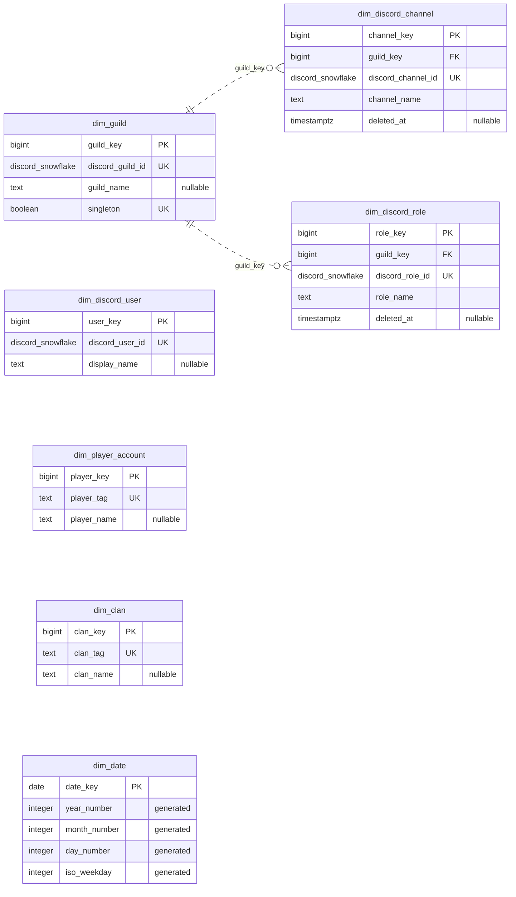
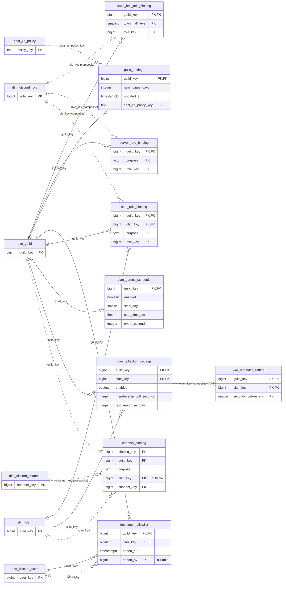
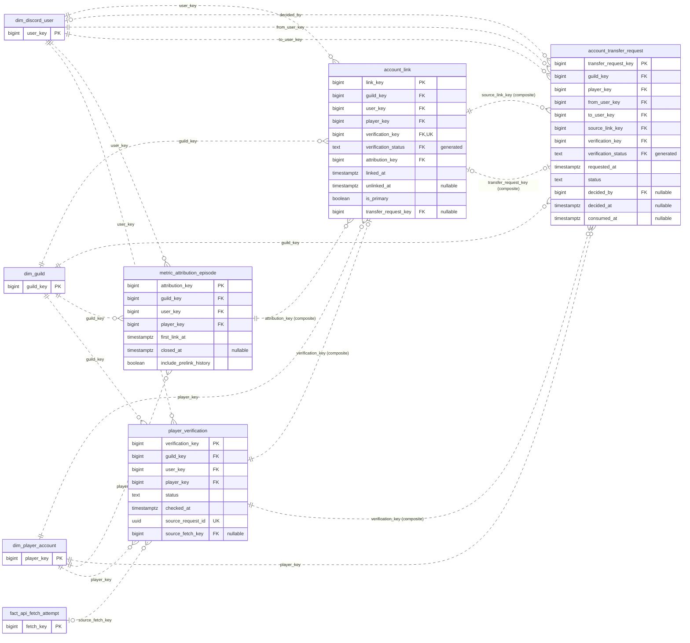
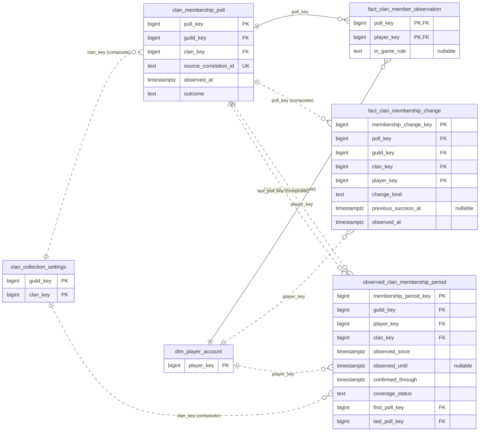
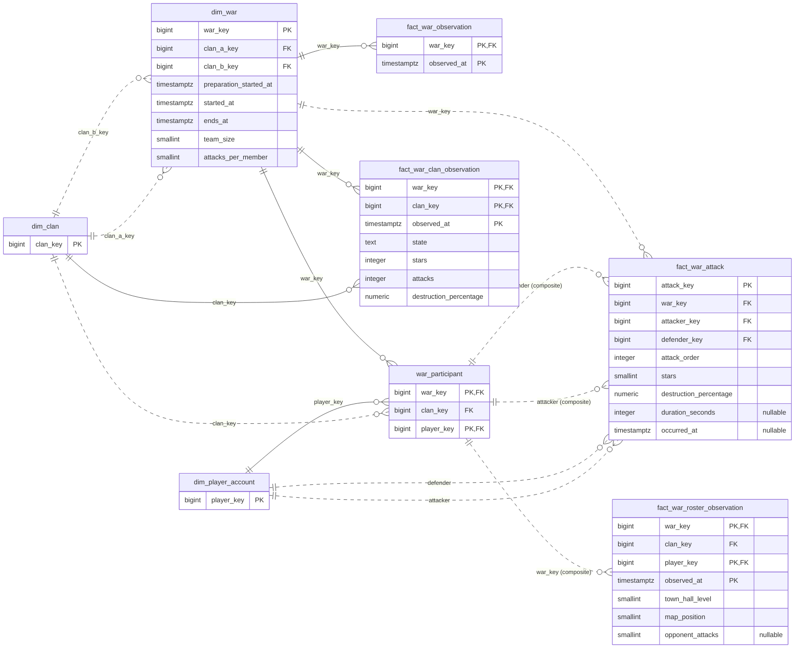
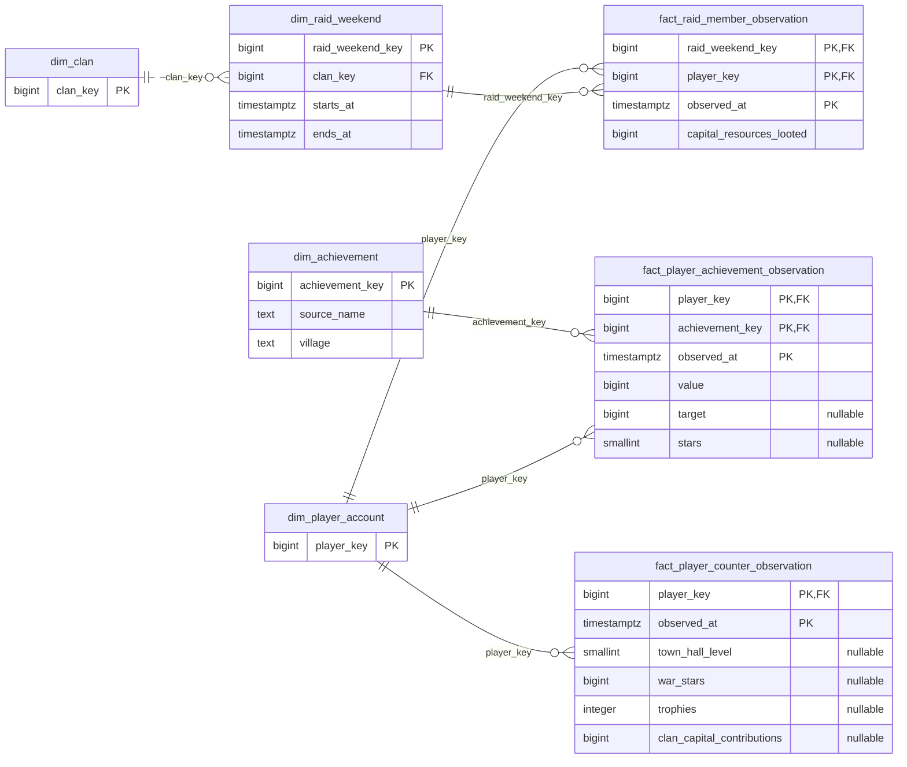
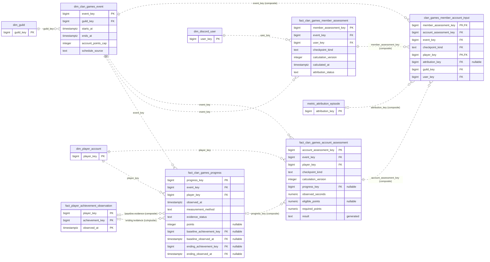
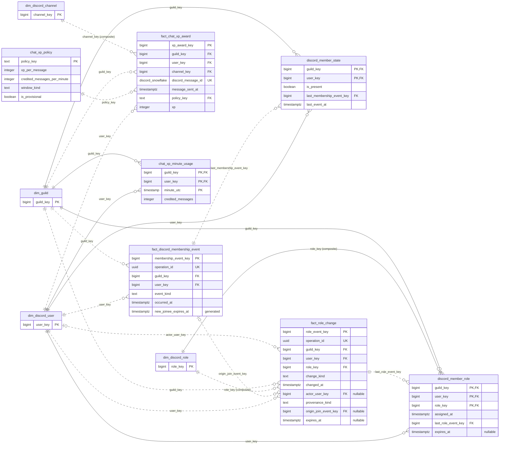
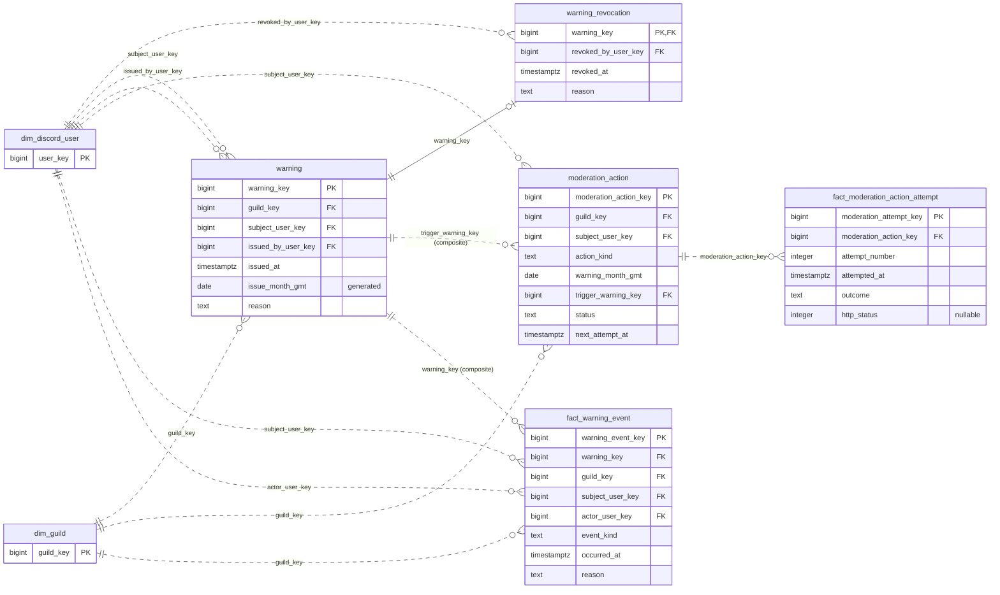
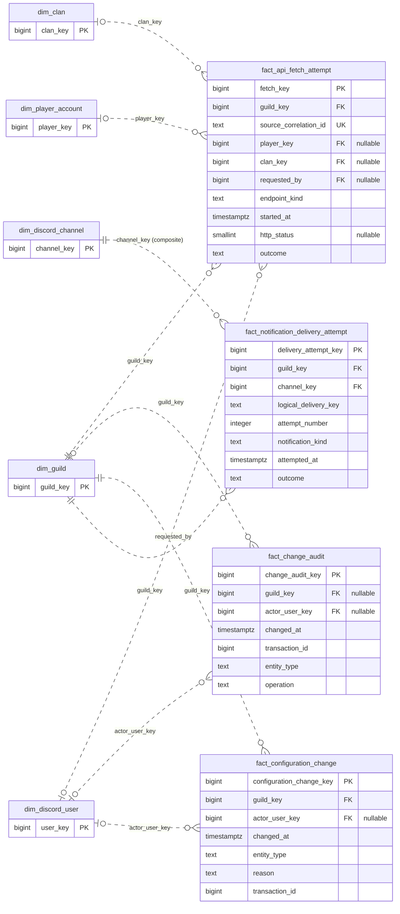

# Guild entity-relationship diagrams

GitHub renders these Mermaid diagrams directly. They reflect all nine current
SQL migrations and were checked against the migrated PostgreSQL 18 catalog.

This page covers **56 persisted tables and 127 foreign keys** in the
`guild` schema. Tables appear once as domain-owned entities; shared parents
reappear as key-only anchors in other diagrams. Flyway history, views, routines,
and triggers are excluded from the physical ER diagrams.

The diagrams show every primary/foreign key and selected business columns.
Composite unique columns are also retained to make fact grains visible.
SQL remains authoritative for all columns, checks, permissions, temporal
exclusions, and conditional uniqueness.

- [SQL migrations](../../services/guild/schema/src/main/resources/db/migration)
- [Schema setup and behavior](../../services/guild/schema/README.md)
- [Requirements and star-schema plan](star-schema-working-plan.md)

## Reading the diagrams

- PK means primary key; FK means foreign key; UK marks a single-column unique constraint.
- A bar pair means exactly one; a circle/bar means zero or one; a circle/crow foot means zero or more.
- Solid lines identify relationships whose FK columns are contained in the child primary key; other lines are dashed.
- Each line represents one declared FK, labeled by its role or a source key. Composite relationships are marked; the reference below lists every component.
- An optional composite MATCH SIMPLE FK is unenforced when any component is null.
- Generated constant verification-status columns are treated as non-null for relationship cardinality.
- Temporal and trigger rules can impose additional conditions beyond the FK notation. In particular, historical account links remain many-to-one even though only one may be active.

## Domains

| Diagram | Domain-owned tables |
| --- | ---: |
| [Shared dimensions](#shared-dimensions) | 7 |
| [Configuration and role mappings](#configuration-and-role-mappings) | 9 |
| [Account links and attribution](#account-links-and-attribution) | 4 |
| [Clan membership evidence](#clan-membership-evidence) | 4 |
| [Regular wars](#regular-wars) | 6 |
| [Player profiles and raids](#player-profiles-and-raids) | 5 |
| [Clan Games](#clan-games) | 5 |
| [Discord presence, roles, and chat XP](#discord-presence-roles-and-chat-xp) | 7 |
| [Warnings and moderation](#warnings-and-moderation) | 5 |
| [Audit, collection, and delivery](#audit-collection-and-delivery) | 4 |

## Shared dimensions

Stable Discord and CoC identities are shared by the activity stars. The date dimension is an optional calendar lookup; no current table declares a foreign key to it.

## Configuration and role mappings

Configuration bindings give Discord IDs a purpose. Role names are display labels. Channel visibility is controlled by Discord; these bindings do not duplicate category ACLs.

## Account links and attribution

Account links describe actual historical ownership intervals. Attribution episodes separately support first-link backfill, same-member continuity, and fresh attribution after transfers. One current owner and one primary are additional temporal/partial-index constraints, not one-to-one cardinalities for the entire history. Verification tokens are not stored.

## Clan membership evidence

Only complete polls can support membership changes. Closing an observed period also requires a matching successful departure fact through a trigger; there is no additional physical foreign key for that proof. Observed time is not an exact in-game join/leave timestamp.

## Regular wars

Clan A/B and attacker/defender are role-playing references to the same dimensions. Roster observations retain historical TH levels. Attack duration is not an occurrence timestamp; attacks are deduplicated by war and attack order.

## Player profiles and raids

Profile counters, cumulative achievements, and running raid totals are snapshots and must not be summed across observations. Raid loot comes from capitalResourcesLooted, independently of profile capital-gold donations.

## Clan Games

Account progress, account assessments, and combined Discord-member assessments have distinct grains. Inputs explicitly identify attribution episodes and evidence. Missing coverage produces insufficient_data. The public progress view omits pass/fail; leadership-only result readers are functions/views and are not physical tables in this diagram.

## Discord presence, roles, and chat XP

Membership and role facts are immutable observations; current-state projections are maintained by triggers. Departures invalidate role authority without deleting identity, links, or XP. XP is one credited message, with a provisional cross-channel five-message cap per fixed UTC minute.

## Warnings and moderation

A warning can have at most one revocation. Five valid warnings in a GMT calendar month create a durable kick decision; execution attempts and confirmed outcomes remain separate. Revocation does not erase the original warning or its audit history.

## Audit, collection, and delivery

These facts retain configuration decisions, stored changes, sanitized API attempts, and notification delivery outcomes. Correlation strings are not foreign keys. Only player_verification.source_fetch_key declares a relationship to an API-fetch attempt. No credentials or verification payloads are included.

## Complete foreign-key reference

All 127 declared foreign keys, including composite columns

These are the actual catalog constraints. Parent-side optionality accounts for
nullable columns; child-side uniqueness includes unconditional unique-key
subsets and the non-null transfer-request uniqueness rule. A unique current
owner index does not limit the cardinality of an entire historical link table.

| Referencing table | Foreign-key columns | Referenced table | Referenced columns |
| --- | --- | --- | --- |
| `account_link` | `attribution_key, guild_key, user_key, player_key` | `metric_attribution_episode` | `attribution_key, guild_key, user_key, player_key` |
| `account_link` | `guild_key` | `dim_guild` | `guild_key` |
| `account_link` | `player_key` | `dim_player_account` | `player_key` |
| `account_link` | `transfer_request_key, guild_key, user_key, player_key` | `account_transfer_request` | `transfer_request_key, guild_key, to_user_key, player_key` |
| `account_link` | `user_key` | `dim_discord_user` | `user_key` |
| `account_link` | `verification_key, guild_key, user_key, player_key, verification_status` | `player_verification` | `verification_key, guild_key, user_key, player_key, status` |
| `account_transfer_request` | `decided_by` | `dim_discord_user` | `user_key` |
| `account_transfer_request` | `from_user_key` | `dim_discord_user` | `user_key` |
| `account_transfer_request` | `guild_key` | `dim_guild` | `guild_key` |
| `account_transfer_request` | `player_key` | `dim_player_account` | `player_key` |
| `account_transfer_request` | `source_link_key, guild_key, from_user_key, player_key` | `account_link` | `link_key, guild_key, user_key, player_key` |
| `account_transfer_request` | `to_user_key` | `dim_discord_user` | `user_key` |
| `account_transfer_request` | `verification_key, guild_key, to_user_key, player_key, verification_status` | `player_verification` | `verification_key, guild_key, user_key, player_key, status` |
| `channel_binding` | `clan_key` | `dim_clan` | `clan_key` |
| `channel_binding` | `guild_key, channel_key` | `dim_discord_channel` | `guild_key, channel_key` |
| `channel_binding` | `guild_key` | `dim_guild` | `guild_key` |
| `chat_xp_minute_usage` | `guild_key` | `dim_guild` | `guild_key` |
| `chat_xp_minute_usage` | `user_key` | `dim_discord_user` | `user_key` |
| `clan_collection_settings` | `clan_key` | `dim_clan` | `clan_key` |
| `clan_collection_settings` | `guild_key` | `dim_guild` | `guild_key` |
| `clan_games_member_account_input` | `account_assessment_key, event_key, player_key, checkpoint_kind` | `fact_clan_games_account_assessment` | `account_assessment_key, event_key, player_key, checkpoint_kind` |
| `clan_games_member_account_input` | `attribution_key, guild_key, user_key, player_key` | `metric_attribution_episode` | `attribution_key, guild_key, user_key, player_key` |
| `clan_games_member_account_input` | `member_assessment_key, event_key, checkpoint_kind, user_key` | `fact_clan_games_member_assessment` | `member_assessment_key, event_key, checkpoint_kind, user_key` |
| `clan_games_member_account_input` | `event_key, guild_key` | `dim_clan_games_event` | `event_key, guild_key` |
| `clan_games_schedule` | `guild_key` | `dim_guild` | `guild_key` |
| `clan_membership_poll` | `guild_key, clan_key` | `clan_collection_settings` | `guild_key, clan_key` |
| `clan_role_binding` | `clan_key` | `dim_clan` | `clan_key` |
| `clan_role_binding` | `guild_key` | `dim_guild` | `guild_key` |
| `clan_role_binding` | `guild_key, role_key` | `dim_discord_role` | `guild_key, role_key` |
| `developer_allowlist` | `added_by` | `dim_discord_user` | `user_key` |
| `developer_allowlist` | `guild_key` | `dim_guild` | `guild_key` |
| `developer_allowlist` | `user_key` | `dim_discord_user` | `user_key` |
| `dim_clan_games_event` | `guild_key` | `dim_guild` | `guild_key` |
| `dim_discord_channel` | `guild_key` | `dim_guild` | `guild_key` |
| `dim_discord_role` | `guild_key` | `dim_guild` | `guild_key` |
| `dim_raid_weekend` | `clan_key` | `dim_clan` | `clan_key` |
| `dim_war` | `clan_a_key` | `dim_clan` | `clan_key` |
| `dim_war` | `clan_b_key` | `dim_clan` | `clan_key` |
| `discord_member_role` | `guild_key` | `dim_guild` | `guild_key` |
| `discord_member_role` | `guild_key, role_key` | `dim_discord_role` | `guild_key, role_key` |
| `discord_member_role` | `last_role_event_key` | `fact_role_change` | `role_event_key` |
| `discord_member_role` | `user_key` | `dim_discord_user` | `user_key` |
| `discord_member_state` | `guild_key` | `dim_guild` | `guild_key` |
| `discord_member_state` | `last_membership_event_key` | `fact_discord_membership_event` | `membership_event_key` |
| `discord_member_state` | `user_key` | `dim_discord_user` | `user_key` |
| `fact_api_fetch_attempt` | `clan_key` | `dim_clan` | `clan_key` |
| `fact_api_fetch_attempt` | `guild_key` | `dim_guild` | `guild_key` |
| `fact_api_fetch_attempt` | `player_key` | `dim_player_account` | `player_key` |
| `fact_api_fetch_attempt` | `requested_by` | `dim_discord_user` | `user_key` |
| `fact_change_audit` | `actor_user_key` | `dim_discord_user` | `user_key` |
| `fact_change_audit` | `guild_key` | `dim_guild` | `guild_key` |
| `fact_chat_xp_award` | `guild_key, channel_key` | `dim_discord_channel` | `guild_key, channel_key` |
| `fact_chat_xp_award` | `guild_key` | `dim_guild` | `guild_key` |
| `fact_chat_xp_award` | `policy_key` | `chat_xp_policy` | `policy_key` |
| `fact_chat_xp_award` | `user_key` | `dim_discord_user` | `user_key` |
| `fact_clan_games_account_assessment` | `progress_key, event_key, player_key` | `fact_clan_games_progress` | `progress_key, event_key, player_key` |
| `fact_clan_games_account_assessment` | `event_key` | `dim_clan_games_event` | `event_key` |
| `fact_clan_games_account_assessment` | `player_key` | `dim_player_account` | `player_key` |
| `fact_clan_games_member_assessment` | `event_key` | `dim_clan_games_event` | `event_key` |
| `fact_clan_games_member_assessment` | `user_key` | `dim_discord_user` | `user_key` |
| `fact_clan_games_progress` | `event_key` | `dim_clan_games_event` | `event_key` |
| `fact_clan_games_progress` | `player_key, baseline_achievement_key, baseline_observed_at` | `fact_player_achievement_observation` | `player_key, achievement_key, observed_at` |
| `fact_clan_games_progress` | `player_key, ending_achievement_key, ending_observed_at` | `fact_player_achievement_observation` | `player_key, achievement_key, observed_at` |
| `fact_clan_games_progress` | `player_key` | `dim_player_account` | `player_key` |
| `fact_clan_member_observation` | `player_key` | `dim_player_account` | `player_key` |
| `fact_clan_member_observation` | `poll_key` | `clan_membership_poll` | `poll_key` |
| `fact_clan_membership_change` | `player_key` | `dim_player_account` | `player_key` |
| `fact_clan_membership_change` | `poll_key, guild_key, clan_key` | `clan_membership_poll` | `poll_key, guild_key, clan_key` |
| `fact_configuration_change` | `actor_user_key` | `dim_discord_user` | `user_key` |
| `fact_configuration_change` | `guild_key` | `dim_guild` | `guild_key` |
| `fact_discord_membership_event` | `guild_key` | `dim_guild` | `guild_key` |
| `fact_discord_membership_event` | `user_key` | `dim_discord_user` | `user_key` |
| `fact_moderation_action_attempt` | `moderation_action_key` | `moderation_action` | `moderation_action_key` |
| `fact_notification_delivery_attempt` | `guild_key, channel_key` | `dim_discord_channel` | `guild_key, channel_key` |
| `fact_notification_delivery_attempt` | `guild_key` | `dim_guild` | `guild_key` |
| `fact_player_achievement_observation` | `achievement_key` | `dim_achievement` | `achievement_key` |
| `fact_player_achievement_observation` | `player_key` | `dim_player_account` | `player_key` |
| `fact_player_counter_observation` | `player_key` | `dim_player_account` | `player_key` |
| `fact_raid_member_observation` | `player_key` | `dim_player_account` | `player_key` |
| `fact_raid_member_observation` | `raid_weekend_key` | `dim_raid_weekend` | `raid_weekend_key` |
| `fact_role_change` | `actor_user_key` | `dim_discord_user` | `user_key` |
| `fact_role_change` | `guild_key` | `dim_guild` | `guild_key` |
| `fact_role_change` | `guild_key, role_key` | `dim_discord_role` | `guild_key, role_key` |
| `fact_role_change` | `origin_join_event_key` | `fact_discord_membership_event` | `membership_event_key` |
| `fact_role_change` | `user_key` | `dim_discord_user` | `user_key` |
| `fact_war_attack` | `attacker_key` | `dim_player_account` | `player_key` |
| `fact_war_attack` | `defender_key` | `dim_player_account` | `player_key` |
| `fact_war_attack` | `war_key, attacker_key` | `war_participant` | `war_key, player_key` |
| `fact_war_attack` | `war_key, defender_key` | `war_participant` | `war_key, player_key` |
| `fact_war_attack` | `war_key` | `dim_war` | `war_key` |
| `fact_war_clan_observation` | `clan_key` | `dim_clan` | `clan_key` |
| `fact_war_clan_observation` | `war_key` | `dim_war` | `war_key` |
| `fact_war_observation` | `war_key` | `dim_war` | `war_key` |
| `fact_war_roster_observation` | `war_key, clan_key, player_key` | `war_participant` | `war_key, clan_key, player_key` |
| `fact_warning_event` | `actor_user_key` | `dim_discord_user` | `user_key` |
| `fact_warning_event` | `guild_key` | `dim_guild` | `guild_key` |
| `fact_warning_event` | `guild_key, subject_user_key, warning_key` | `warning` | `guild_key, subject_user_key, warning_key` |
| `fact_warning_event` | `subject_user_key` | `dim_discord_user` | `user_key` |
| `guild_settings` | `chat_xp_policy_key` | `chat_xp_policy` | `policy_key` |
| `guild_settings` | `guild_key` | `dim_guild` | `guild_key` |
| `metric_attribution_episode` | `guild_key` | `dim_guild` | `guild_key` |
| `metric_attribution_episode` | `player_key` | `dim_player_account` | `player_key` |
| `metric_attribution_episode` | `user_key` | `dim_discord_user` | `user_key` |
| `moderation_action` | `guild_key` | `dim_guild` | `guild_key` |
| `moderation_action` | `guild_key, subject_user_key, trigger_warning_key` | `warning` | `guild_key, subject_user_key, warning_key` |
| `moderation_action` | `subject_user_key` | `dim_discord_user` | `user_key` |
| `observed_clan_membership_period` | `first_poll_key, guild_key, clan_key` | `clan_membership_poll` | `poll_key, guild_key, clan_key` |
| `observed_clan_membership_period` | `last_poll_key, guild_key, clan_key` | `clan_membership_poll` | `poll_key, guild_key, clan_key` |
| `observed_clan_membership_period` | `guild_key, clan_key` | `clan_collection_settings` | `guild_key, clan_key` |
| `observed_clan_membership_period` | `player_key` | `dim_player_account` | `player_key` |
| `player_verification` | `guild_key` | `dim_guild` | `guild_key` |
| `player_verification` | `player_key` | `dim_player_account` | `player_key` |
| `player_verification` | `source_fetch_key` | `fact_api_fetch_attempt` | `fetch_key` |
| `player_verification` | `user_key` | `dim_discord_user` | `user_key` |
| `server_role_binding` | `guild_key` | `dim_guild` | `guild_key` |
| `server_role_binding` | `guild_key, role_key` | `dim_discord_role` | `guild_key, role_key` |
| `town_hall_role_binding` | `guild_key` | `dim_guild` | `guild_key` |
| `town_hall_role_binding` | `guild_key, role_key` | `dim_discord_role` | `guild_key, role_key` |
| `war_participant` | `clan_key` | `dim_clan` | `clan_key` |
| `war_participant` | `player_key` | `dim_player_account` | `player_key` |
| `war_participant` | `war_key` | `dim_war` | `war_key` |
| `war_reminder_setting` | `guild_key, clan_key` | `clan_collection_settings` | `guild_key, clan_key` |
| `warning` | `guild_key` | `dim_guild` | `guild_key` |
| `warning` | `issued_by_user_key` | `dim_discord_user` | `user_key` |
| `warning` | `subject_user_key` | `dim_discord_user` | `user_key` |
| `warning_revocation` | `revoked_by_user_key` | `dim_discord_user` | `user_key` |
| `warning_revocation` | `warning_key` | `warning` | `warning_key` |

## Maintenance

When migrations change tables or constraints, update the affected domain
diagram and the complete FK reference together. Validate against a disposable
database prepared through the normal Flyway workflow. Do not reset real data
or alter migration checksums to regenerate documentation.
